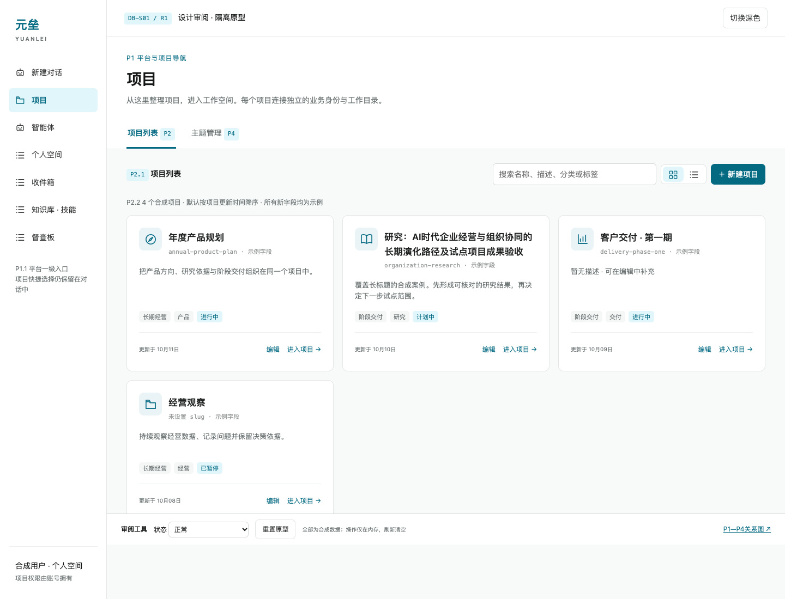
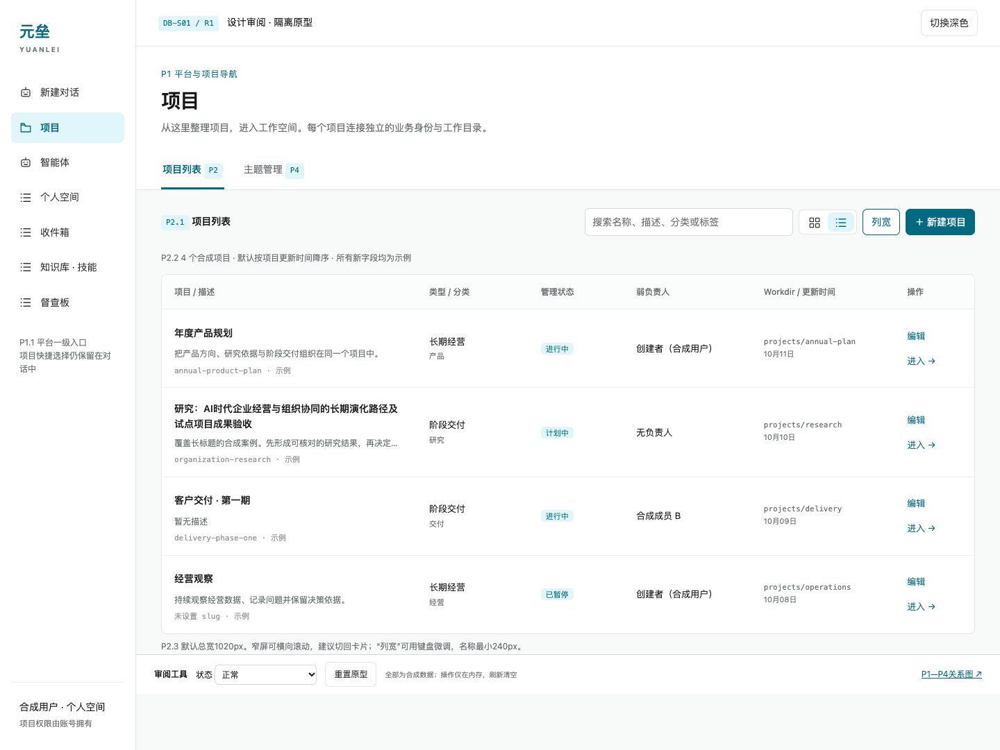
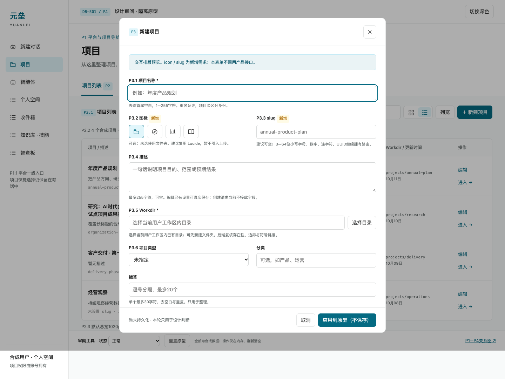
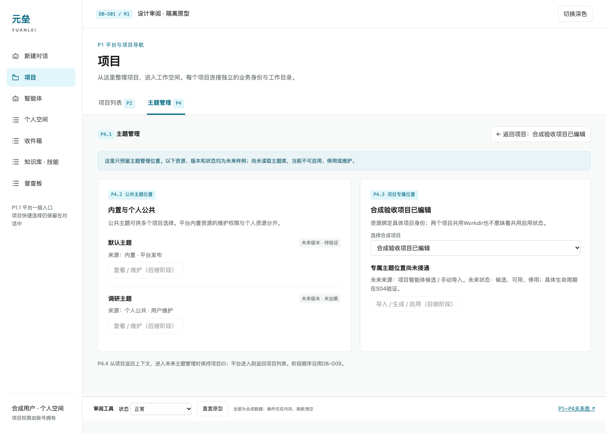
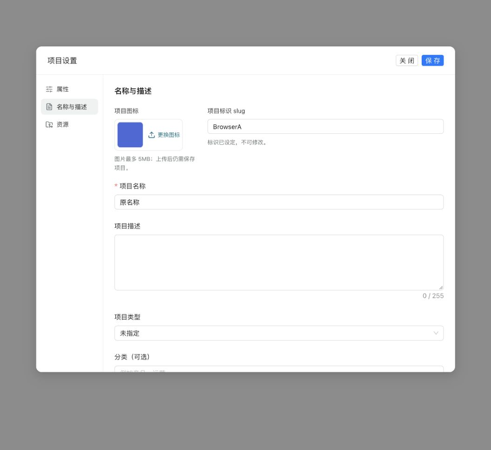
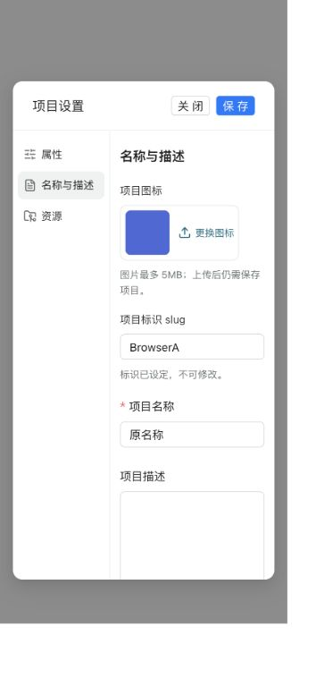
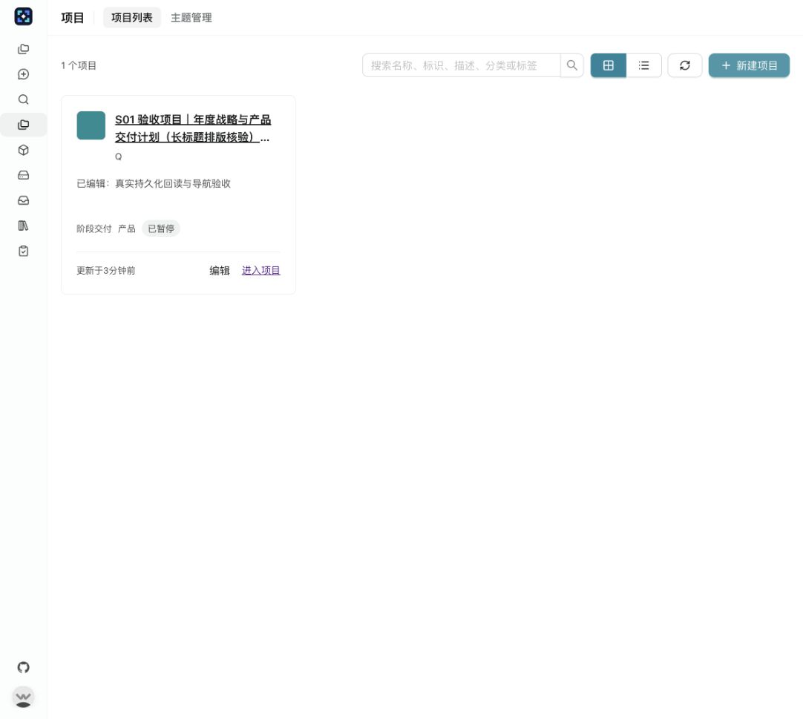

# SYS-DB-001｜项目主题与 Dashboard 需求及设计方向

版本：2.1，2026-10-12。读者：用户、设计与开发执行者。本文拥有产品方向和当前待验证问题；实施见[DEV-DB-001](DEV-DB-001-Dashboard开发任务与实施约束.md)，事实与阶段判断见[LOG-DB-001](LOG-DB-001-Dashboard进度基线与执行记录.md)。R3技术路线已获用户采纳；当前实施指南见DEV-DB-002，调查材料只供归档追溯。前版细节见[历史快照](归档/2026-10-11-渐进推进前/README.md)。

## 1. 产品方向：项目主题

元垒维持个人先用、项目扁平管理、负责人弱关联，组织权限放第三阶段。项目主题是项目的表现与组织方案，覆盖 Dashboard、工作台、议题、讨论、决定与任务入口，包含布局、局部导航、显示名称和内容呈现。主题不局限于颜色，也不局限于首页大屏。

同一套议题能力可在不同项目中显示为“议题”“课题”“战略规划”。主题声明显示名称和用途，业务仍使用稳定对象身份、状态与接口；改名不自动产生一种新业务类型。并非所有战略规划内容天然都适合议题，涉及蓝图或目标的内容仍归真实职责。正式批准、替代、撤销、任务接受等语义与权限由原业务Owner执行。

先建设主题基础框架，再强化默认主题的人机交互。基础阶段的“默认”“调研”是用于验证不同组织方式的两个具名样板，不宣称默认主题已达到最终日常管理体验。

## 2. 项目管理入口

平台一级导航新增“项目”，与“智能体”并列。项目管理包含二级入口“项目列表”“主题管理”。项目列表顶部有搜索、新增项目、卡片/列表切换；参考智能体管理的现有设计语言，按项目信息重新安排密度，不复制所有属性。

卡片默认突出图标、名称、简短描述和主要进入动作，slug及其他元数据按价值安排。列表提供核心默认列、合理默认宽度和可调列宽，列选择及偏好范围在当前设计中说明。长名称、空描述、大量项目、空/错/加载和窄屏均须展示。

新增项目表单参考新增智能体的体验，目标字段为名称、图标、slug、描述及现有项目属性。已有可选归属保持可选；名称/slug校验、现有Workdir创建意图不能被“非强制”笼统取消。字段缺失先在设计稿标新增，不做假保存。slug是否可变、唯一范围和旧链接迁移由当前字段调研确定。

主题管理展示内置、个人公共、项目专属资源及其版本、可用/停用状态、来源和维护入口。全局主题管理与项目选择/配置有不同范围，最终导航如何返回项目由样板验证。停用不默认破坏已绑定项目，处理方式在加载阶段验证。

## 3. 前端先行与已采纳技术

S01项目入口已验收；S02 R3路线已获用户采纳：现有Vue可信组件注册＋受控JSON及内容资源。后续按同一包、数据、保存和迁移契约实施，不再启动候选选型。具体工作落点、支持范围和各段验证由[DEV-DB-002](DEV-DB-002-项目主题实施指南.md)拥有，研究仅供归档追溯。

下一实施段S03先在独立预览入口形成默认/调研两主题六页，复用现有Vue组件与样式。模拟数据明确标识，验证组织差异、切换和返回；持久保存、真实数据与迁移分别在S04—S06按既定路线接通。尚未接通的操作显示未接通，不将演示成功写成产品能力。当前只完成执行指南与归档，S03尚未启动。

可信平台组件承担加载、导航和业务动作；生成内容限于受控定义与声明资源，不获得自由脚本、任意接口或业务写权限。格式与能力边界按指南第3节执行，增加自由执行或授权范围须明示新的范围与代价。

## 4. 文件存储、公共与专属资源

目标是两主题各有可管理的文件包、明确身份及版本，可加载、切换、编辑和维护。公共主题受保护，与用户/项目可写内容隔离；项目智能体生成主题进入该项目的候选来源，不直接覆盖公共资源。

文件字节与项目业务身份分别核对，不能因两个项目共用Workdir就共享主题启用状态。指纹用于检测字节一致性，不等于可信来源或授权；受保护资源还需写权限与来源校验。公共/个人/项目候选按来源授权进入受保护服务文件域；发布版本不可变，PG保存版本引用与Project绑定，候选修改不自动启用。提交顺序与恢复由S02贯通试验验证并在DEV-DB-002第5节明确；S04按同一模型落地实际DDL/管理，不重新选择保存方式。

主题包与业务报告分开。项目交付报告等文件通过现有Workdir/对象边界在项目资料中管理；业务验收、状态、权限仍由现有数据库事实维护。具体报告落点及引用方式需要核对已有实现后接入，不能从需求推定现有文件已经完整。

## 5. 两类数据协议与宿主交互

系统数据维度覆盖项目属性、议题、讨论、决定、工作/任务、执行与准确交付，由现有业务服务按项目和用户范围供给。项目资料维度读取明确授权的项目文件，例如指定JSON、图片、HTML、Markdown及报告，表达来源、类型、版本/指纹、时间和读取错误。

主题需要声明数据需求、呈现及可用动作。DEV-DB-002第6节明确固定宿主数据适配及Project授权＋Workdir窄文件用例，第3节明确同项目/包版本/页返回与迟到响应隔离，S05据此实现生产服务和权限验证。报告文本不能代替任务成功事实，缓存不能替代权限检查，主题传入项目或对象ID不能决定可见性。

页面应能解释未绑定、空数据、缺文件、过期、无权和加载失败。点击治理或办理动作进入原业务能力，准确对象与返回位置保留；是否可在主题内嵌可信办理组件由真实验证确定。用户指定的项目文件不等于允许扫描全部目录或读取任意路径。

## 6. 导入导出与后继能力

数据协议初步验证后，主题导出包含可迁移结构、资源、逻辑数据需求、版本/依赖声明和指纹，不默认打包凭据、用户身份、业务行和真实项目绑定。导入显示缺依赖/待绑定，重新校验并预览，不默认启用。

“不同平台”首个可验证含义是两套元垒实例或环境之间迁移。任意其他产品直接执行主题需双方兼容运行时/协议或适配器，在调研中说明可移植边界，不能承诺一个包天然在所有平台运行。源平台项目ID和路径不能原样变成目标平台授权。

基架验证后，再细化默认主题的蓝图阅读、议题一体详情、决定与任务分层、收件箱和日常办理体验。真实Agent生成、有限自主维护、模板升级/多实例等原目标保留为后继待细化需求；其是否属于本轮基础框架收尾须在阶段评审明确，不按旧T卡自动开工。协作/Andon保持暂停。

## 7. 方向稳定，细节逐段形成

持续目标是：项目管理可发现，主题可维护，默认/调研能独立加载切换，两类数据可准确呈现，主题可跨环境迁移，最终日常页面适合人思考和维护。当前阶段只明确其可验证结果和不能破坏的已有事实。

每个关键阶段依据真实页面、文件、协议与故障证据决定保留、调整或替换方案。技术细节和后继拆分更新到DEV，用户决定与证据写LOG。过程可随时触发中断重审，具体机制由[DEV-MG-001](DEV-MG-001-专项推进与设计汇报机制.md)维护。

## 8. DB-S01｜项目入口设计审阅 R1

读者：设计审阅者与后续实施者。R1为初次审阅稿，当前P1—P4已确认，落地修订以第8.8节为准；目标是让用户发现、整理、创建、编辑并进入项目，验收依据是入口关系、信息可读性、字段真实能力及持久化回读。假设一期仍为个人拥有项目、扁平管理、负责人弱关联。协作接入与Andon暂停，主题运行时、组织权限、议题与决定状态机属于范围外。

### 8.1 完整页面全景与阅读顺序

<a href="图解/11-s01-entry-20261011/project-entry.html" target="_blank" rel="noopener">打开P1—P4可操作隔离原型</a>，先看P1平台外壳与P2完整列表，再打开“新建项目”看P3，最后切换“主题管理”看P4。审阅工具提供正常、加载、首次空状态、错误、刷新失败和48项合成数据；切换卡片/列表、调整列宽、搜索、编辑、目录选择及返回路径均可操作。所有数据为合成，表单按钮明确为“应用到原型（不保存）”；内存修改刷新即清空，没有产品HTTP请求或数据库写入。手工HTML原型用于判断布局，产品实施复用已有Vue、Ant Design Vue与Lucide，不将原型脚本复制成第二套产品框架。

阅读顺序为左侧P1.1一级入口→P1.2页面标题与二级导航→P2.1搜索/视图/新增→P2.2项目身份与摘要→P2.3进入或编辑。全景使用现有青色、灰阶、边框及轻圆角；标题与描述留足行高，状态只用一枚轻标签。卡片之间保持16px间距，主要动作稳定在底部。原型深浅色token取自现有base.css/base.dark.css，底部审阅条仅属于设计工具。

<a href="图解/11-s01-entry-20261011/navigation.html" target="_blank" rel="noopener">DB-G10｜P1—P4入口关系</a>及<a href="图解/11-s01-entry-20261011/save-flow.html" target="_blank" rel="noopener">DB-G11｜P3候选保存与回读序列</a>由Archify生成。两图保留初次审稿的待确认标签，设计关系已确认，包含待实施连接；不声明这些请求或主题能力已装配。顺序推进继续以DB-G09为准。

### 8.2 P1｜平台与项目导航

P1.1在“新建对话”和“智能体”之间新增“项目”，保留个人空间、收件箱、知识库·技能、督查板及超级管理员数据总览入口。权限规则沿用现有路由依赖，不新增管理角色。建议新增登录用户路由`/projects`，二级“项目列表/主题管理”使用`?tab=projects|themes`，复用PageHeader的标题、tab与加载状态模式；切换tab使用路由query，刷新或返回可恢复位置。

P1.2区分平台项目管理与项目工作空间。管理页不挂具体project_id，不显示某个项目的局部导航。P1.3标题或“进入项目”进入现有`/projects/:project_id/dashboard`；现有ProjectLayout继续拥有概览、工作台、工作、项目智能体和资料路径，资料沿用工作区`open=workdir_path`。对话中的项目选择器及聊天侧栏快捷入口保留；项目管理不替代对话选择，也不改变Conversation的项目归属。项目内增加“返回项目列表”路径，保留管理页搜索及视图；主题管理从项目入口进入时携带该项目UUID，返回该项目而非邻近或最近项目。

推荐平级一级入口，原因是管理行为需要稳定可发现位置，并与智能体管理区分对象。替代是只扩大聊天侧栏项目区，改动较少但管理入口仍依赖对话上下文；另一替代是在项目详情侧边栏放管理页，会混淆“所有项目”与“当前项目”。平台其余入口的命名、顺序及项目内页面内容保持现有职责。

### 8.3 P2｜项目列表

P2.1左侧说明当前列表，右侧依次搜索、视图切换、新增；搜索框桌面宽300px，窄屏独占一行。搜索在当前可见集合内匹配名称、slug、描述、分类与标签，不使用未授权项目；空查询恢复全部，零匹配提供清除搜索。默认按Project.updated_at降序，同值以UUID稳定排序。这个时间表示项目记录更新，不表示任务活动。类型/分类/标签的高级筛选可继续复用既有ProjectFilters，但R1先不堆叠筛选器或建设自定义列系统。

P2.2卡片默认视图突出icon与名称，名称最多两行且按词/任意长串换行；完整标题通过title及进入后完整页头读取。描述两行，空描述显示“暂无描述”；slug是次要标识，未设不生成假身份。卡片只显示用途类型、分类与管理状态，底部更新时间、编辑和进入项目。负责人、优先级、日期不在卡片平铺，编辑时查看。卡片主按钮与标题进入同一UUID的概览；编辑独立打开P3，不因卡片空白区点击误入项目。

P2.3列表用身份信息及管理维度做横向比较，默认总宽1020px：

| 默认列 | 宽度 / 下限 | 阅读层级与行为 |
| --- | --- | --- |
| 项目 / 描述 | 320 / 240px | 名称两行、描述一行、slug弱显示；标题进入项目 |
| 类型 / 分类 | 140 / 100px | 用途在上、分类在下；标签留给搜索与编辑 |
| 管理状态 | 120 / 100px | 使用work_status，不能把Project.active当进行中 |
| 弱负责人 | 160 / 100px | 显示有效名称或无负责人；失效关联显示不可用，不猜姓名 |
| Workdir / 更新时间 | 180 / 100px | 相对路径可折行，时间在下；编辑中查看完整路径 |
| 操作 | 100 / 固定 | 编辑、进入；不在本轮新增删除入口 |

列宽按钮只调整前五列，提供滑杆及键盘操作、恢复默认；名称上限600px，其余320px。默认不建设列选择、拖拽配置或跨用户偏好数据库，宽度仅当前管理会话保留。宽屏弹性分配剩余空间，窄屏只在表格容器横向滚动，整页不溢出，并提示切回卡片。替代为全自动列宽，控件更少但长标题会挤压属性；全列拖拽/配置功能更强，但会扩大交互与偏好维护面。R1推荐有界手动调整。

P2.4加载展示骨架和读取提示；第一次空状态突出“新建项目”；搜索无结果提供清除；首次加载失败显示重试且不显示假零数量。刷新失败保留上次列表，显示旧数据与刷新错误。48项场景证明滚动和搜索；大量项目的接口分页需要另据实际规模确定，本轮不宣称已有分页。视图与搜索保存在管理页会话/返回上下文，不改变真实项目选择。

### 8.4 P3｜新建与编辑

P3采用760px居中表单，标题、关闭及底部提交稳定，内容区独立滚动；窄屏单列。基本身份、目的、Workdir和用途默认展开，管理状态/弱负责人/优先级/日期收在“更多管理属性”。名称与目录在首次创建必填，其余默认或可选。完整属性一次提交，避免用户在创建后逐个页面补字段。以下为待实施的产品目标，原型没有调用settings接口，因此未演示读取/提交失败、未保存提醒、绑定智能体负责人和失效关联；原型已演示本地字段校验及内存创建/编辑。编辑先读取settings，失败时给重试，不展示可提交的空表单；提交中防重复，失败保留输入，关闭有未保存提醒。

| 模块 / 字段 | 设计与校验 | 当前能力 / 所需增量 |
| --- | --- | --- |
| P3.1 name | 必填，trim后1—255字符；允许同名，UUID拥有身份 | 创建、重命名、完整settings保存已有 |
| P3.2 icon | 可选，复用智能体图片上传（5MB），上传与保存项目是两个动作 | 调研时均无icon；已确认增量放ProjectSettings并复用图像上传 |
| P3.3 slug | 可空；填入时1—64位大小写字母/数字/连字符，首尾非连字符；全局不区分大小写唯一，保留输入大小写，设定后不可修改 | 调研时无项目slug；隔离实现位于ProjectSettings，本地待迁回；不借用Agent.slug |
| P3.4 description | 可空，最多255字符 | settings读写已有；创建不接；列表不返回 |
| P3.5 Workdir | 创建必选当前uid工作区内非根已有目录；复用WorkspacePathPicker选目录/新建文件夹/历史目录能力 | 手动create service仅接受linked；编辑无换绑能力，显示只读 |
| P3.6 类型、分类、标签 | 类型默认未指定；分类≤50；标签≤20，每项≤30，trim、去重 | settings读写及列表类型/分类/标签摘要已有；创建不接 |
| P3.7 管理状态、优先级 | 默认planned/none；既有枚举照用 | settings已有；不触发任务执行或更改决定状态机 |
| P3.7 负责人 | 默认创建者，可选无/有效平台成员；编辑可选已绑定项目智能体 | settings弱关联已有；新项目尚无绑定智能体，不能伪造候选 |
| P3.7 日期 | 可空，开始≤截止，阶段交付显示“交付日期” | settings已有；日历日期不进行时区转换 |
| 账号归属uid | 只读，来自认证用户；不新增部门、企业或权限转移字段 | repository按uid限定可见性，弱负责人不授权 |

2026-10-11用户已明确批准icon／slug前后端同步开发，并否定因后端缺字段而削减功能。slug保留大小写，`A`与`a`冲突；不与负责人、账号归属绑定唯一范围。已设slug不能修改、清空或仅改大小写；旧项目未设时保留空值，可首次设置。UUID路由、Conversation、Run、Workdir继续使用现有身份。唯一约束覆盖保留的软删除记录，数据库表达式索引与不可变触发器承担并发和替代写入路径的最终约束。1—64位ASCII字母/数字/连字符、首尾字母或数字为实现选择；是否将新建slug设为必填尚未增加要求。

Workdir不接受宿主路径、runtime路径或任意字符串；前端选择器提供相对路径，服务端由Workdir/no-follow边界复核。新建文件夹与创建项目是两个真实动作，创建失败后目录可能保留，必须给出路径和继续选择的办法，不能悄悄删除目录。多个项目共用目录是现有能力，编辑页说明共享字节但业务身份独立；本轮不增加换绑目录功能。

建议最小后端增量是：扩充当前项目用例的创建请求，使Project与完整管理属性同事务提交；在yuanlei管理属性域补icon/slug和唯一约束并升级元垒schema；列表批量返回描述、work_status、弱负责人显示及icon/slug。继续沿project service/repository和settings Owner，不另建管理服务或主题表。幂等创建指纹须覆盖新增属性，复用request_id不得接受变化的意图。备选为创建后再调settings，但第二步失败会产生半成品；若选择该备选，必须显示“项目已创建、属性保存失败”并按已有ID重试，不能报整体成功或重复创建。R1推荐一次完整创建；icon／slug增量已获确认并在隔离工作树实施；完整管理属性创建、其他列表摘要与P1—P4页面已由用户确认，按8.8节实施。

### 8.5 P4｜主题管理占位

P4.1顶部保持项目管理二级导航，清楚标“管理位置未接通”。P4.2左侧内置/个人公共位置，展示未来来源与维护职责；P4.3右侧选择具体项目查看专属位置，展示项目智能体候选/手动导入来源。版本与候选/可用/停用只是未来样例，实际接口接入前不显示数量统计、真实版本或“已启用”。所有导入、生成、启用、停用按钮禁用并解释后继阶段；本阶段不实现绑定、模板框架或主题运行时。

P4.4从平台进入返回项目列表；从具体项目进入保留UUID并返回该项目，切换专属项目后按当前项目返回。推荐在同一管理页并列公共与专属位置，让用户先理解范围，再选择具体对象。替代为独立主题一级入口，库较大时更清楚，但会增加平台入口、削弱项目关系；全部塞入项目设置则难发现公共主题。R1采用二级占位，S02/S03试验后再决定维护细节。

源码核对入口：[平台与项目外壳](https://github.com/Sxyon/Yuanlei/blob/main/web/src/layouts/AppLayout.vue)、[项目API契约](https://github.com/Sxyon/Yuanlei/blob/main/backend/server/routers/project_router.py)、[项目创建与列表用例](https://github.com/Sxyon/Yuanlei/blob/main/backend/package/yuxi/services/project_service.py)、[完整管理属性用例](https://github.com/Sxyon/Yuanlei/blob/main/backend/package/yuxi/services/project_settings_service.py)、[Project与ProjectSettings持久化模型](https://github.com/Sxyon/Yuanlei/blob/main/backend/package/yuxi/storage/postgres/models_business.py)。实际调查版本由LOG第12节固定，不用主分支链接推定未来源码保持不变。

### 8.6 本轮集中审阅与后续验收

R1四组页面组织及完整属性原子创建已确认；图标采用用户要求的上传方式，slug规则以P3表和R2为准。列宽调整推荐只在会话保留；Workdir编辑只读，资源配置继续沿现有设置。接受部分范围时，以P号/字段列出确认范围，LOG记录原用户反馈与R1版本，未确认部分继续留设计。

后续实施以真实HTTP和持久化回读证明创建/编辑全部批准字段，测试同名、slug并发冲突/跨用户隔离/幂等意图变化、无效目录与日期、失效负责人、旧项目缺字段默认值。浏览器验证列表/卡片、搜索、长标题、列宽、空错、导航与准确返回。独立Reviewer核对完整需求、用户确认范围、diff与证据。只有S01产品出口通过才进入S02；原型检查不替代产品验收。

### 8.7 已确认身份字段实施范围 R2

R1全景和截图保留为设计审阅历史；当前身份规则以本节和P3表为准。复用现有创建弹窗和项目设置“名称与描述”页，加入图标上传预览与slug；设置成功后锁定slug。上传失败保留原图，正在上传时不允许保存；切换项目后的迟到上传不污染新项目。创建用例同事务写Project与icon／slug，列表和编辑回读均含字段。持久化只增加yuanlei.project_settings两列，版本37→38，不更改上游Project表。

R2时点授权只确认icon／slug字段；后续P1—P4整体授权见第8.8节。S01总体验收和S02进入仍关闭。字段验证使用隔离真实PostgreSQL／HTTP／MinIO，不迁移日常数据库。

字段产品桌面回读（隔离测试账号，真实HTTP／PG／MinIO）及窄屏检查：

R2设计稿保留独立内存演示；R1的33项原型回执对应旧指纹，仅证明R1历史版本。R2本轮浏览器核对上传入口、单字符大写创建和编辑只读，并以新截图留证；不会把原型成功当作产品持久化证据。

### 8.8 P1—P4确认后的落地约束 R3

用户确认P1—P4排版与计划。项目管理二级导航复用智能体管理的PageHeader与tab样式，正式页面不显示原型编号、独立大标题和“从这里整理项目…”说明区。现有Vue、Ant Design Vue和平台样式拥有产品外观，原型用于说明布局与操作，不要求像素复刻。Workdir选定、新建文件夹、历史目录和路径操作沿用WorkspacePathPicker及现有流程；编辑保持现有绑定边界。

批准范围包含项目一级入口、列表搜索/新增/卡片与列表/有界列宽、完整管理属性新建与编辑、icon上传、全局不区分大小写且设定后不可变的slug，以及公共/项目专属主题管理占位。完整属性创建同事务保存，列表批量读取摘要。主题运行时、议题与决策状态机、协作接入与Andon仍不在范围内。

工作只在用户当前本地checkout与分支推进，保留其他会话未提交改动。先提交设计及确认记录，再继续产品实施。前轮隔离工作树中的字段实现与验证属于历史工程准备，迁回本地并验证后才作为本地产品事实；S01整体仍待实施与验收。导航/保存关系未改变，DB-G10/11沿用已校验设计图。

### 8.9 本地产品交付与S01验收 R4

P1—P4已按R3批准范围实现。项目一级入口进入`/projects`，PageHeader仅提供紧凑项目标题及“项目列表／主题管理”，不带原型说明区。卡片突出名称、图标与描述；列表默认宽度320／140／120／160／180，加操作100px，支持有界调整及恢复默认。搜索覆盖当前可见项目的名称、slug、描述、分类和标签；会话内保留视图、搜索与列宽。长标题截行并可查看完整文本，窄屏表格局部横向滚动。

新建复用ProjectCreateModal，项目管理入口与旧选择入口共用；Workdir沿用WorkspacePathPicker及目录创建流程。完整管理属性与Project在同一事务保存，失败保留输入和目录，同意图重试用原request_id，改变有效字段必须使用新意图。编辑复用ProjectSettingsModal，既有Workdir与账号只读，首次设置后的slug锁定；后端及PG直接写入路径最终执行不可变、格式和全局不区分大小写唯一。版本38只向yuanlei.project_settings增加icon／slug，列表批量补描述、状态和负责人名称，弱归属仍不授权。

主题页面区分公共与项目专属的未来来源及“管理接口未接入”，保留项目选择及准确返回项目的路径，无主题加载、生成、导入运行时。真实页面见下图；逐项证据与限制由LOG第15节登记。S01出口通过，S02具备领取前提，本轮未启动S02；协作接入与Andon继续暂停。

## 9. 已采纳的项目主题技术路线

用户2026-10-12明确“采纳方案”，对象为S02 R3完整路线及首批支持边界，确认原文见LOG最新节。S01已验收76/100“基本能用，审美较差”，作为样板设计改进依据。产品主题运行时尚未实施；当前执行依据为[DEV-DB-002实施指南](DEV-DB-002-项目主题实施指南.md)，阶段领取由DEV-DB-001拥有。研究基线与试验事实留[归档](归档/2026-10-12-DB-S02技术调研/README.md)，不能把d2bf7134或lab结果当后续当前实现。

已采纳：Vue原生固定可信组件注册＋受控JSON/资源包；FastAPI/Pydantic拥有正式契约；独立受保护服务文件卷保存不可变ZIP，PostgreSQL yuanlei域保存来源/版本及Project绑定；系统数据沿原业务Owner、指定文件经Project授权后走现有Workdir；原字节导出，同format/ABI目标导入再授权Project与文件绑定。内置/个人公共/项目专属来源隔离，发布字节不覆盖，候选修改不自动升级当前选择；文件发布先于PG登记、旧generation更新拒绝，异常保留可信入口。详细工作步骤及字段Owner由实施指南拥有。

支持多页面、有限布局/显示名/资源、项目/议题/讨论/决定/正式任务呈现、原宿主准确办理/返回，资料按需选择JSON/PNG/Markdown正文/静态HTML。首批生成包不含自由JS/任意组件/任意请求URL或路径；迁移不结构化携认证/本地绑定/业务行，不承诺任意第三方产品原生运行，不保证用户自行打包文案/资源自动脱敏。正式任务与治理工作建议保持类型区别，显示别名不改对象状态。

S03六页/契约/预览→S04来源/版本/受保护包/PG选择→S05真实业务与指定文件→S06两正式元垒环境导入/重绑定→S07默认主题日常体验，按同一方案逐段实施及验证效果。产品权限、正式Schema迁移、管理/维护工具、备份容量和模型质量尚未验证，不冒充已完成。当前只生成指南并归档；S03未启动，协作与Andon继续暂停。技术采纳与用户实验阶段验收分开记录，不以Review或沉默替代。
