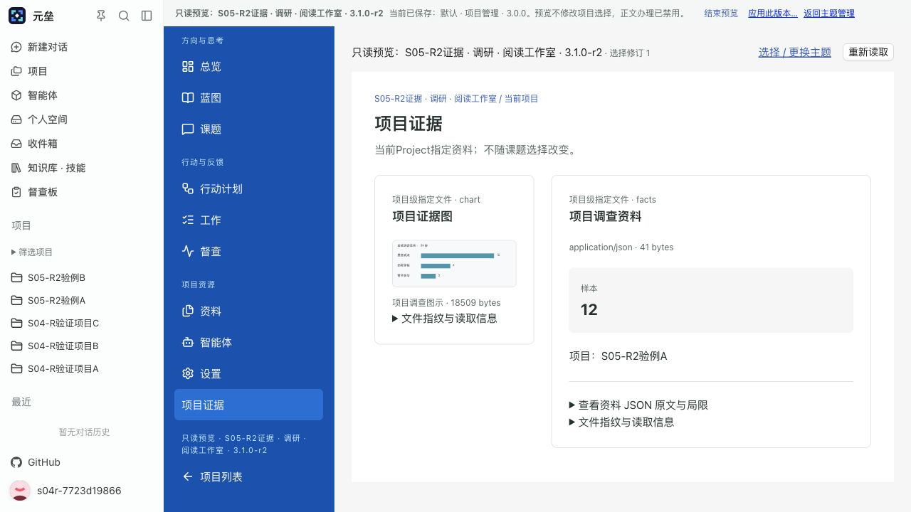
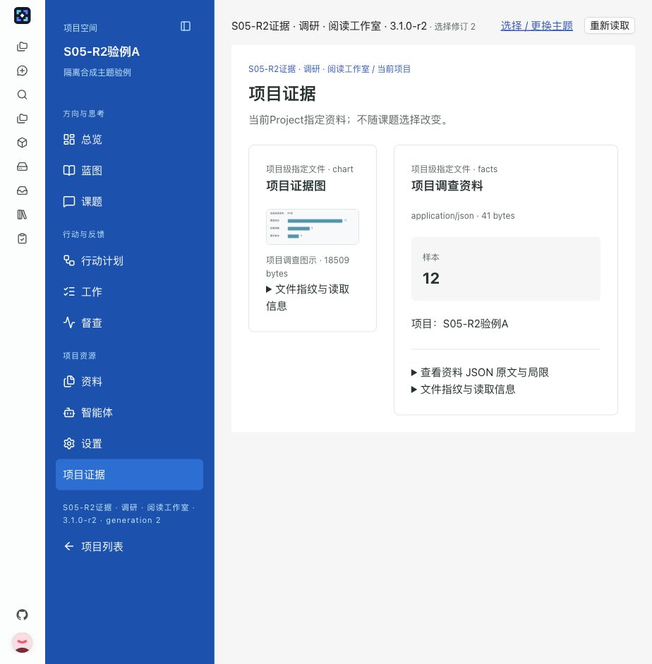
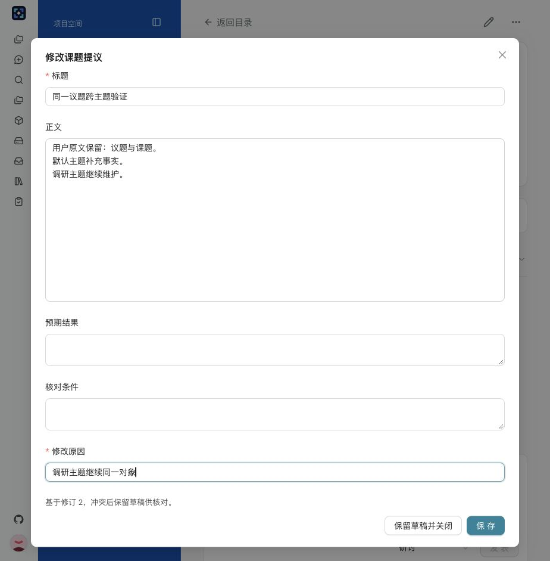
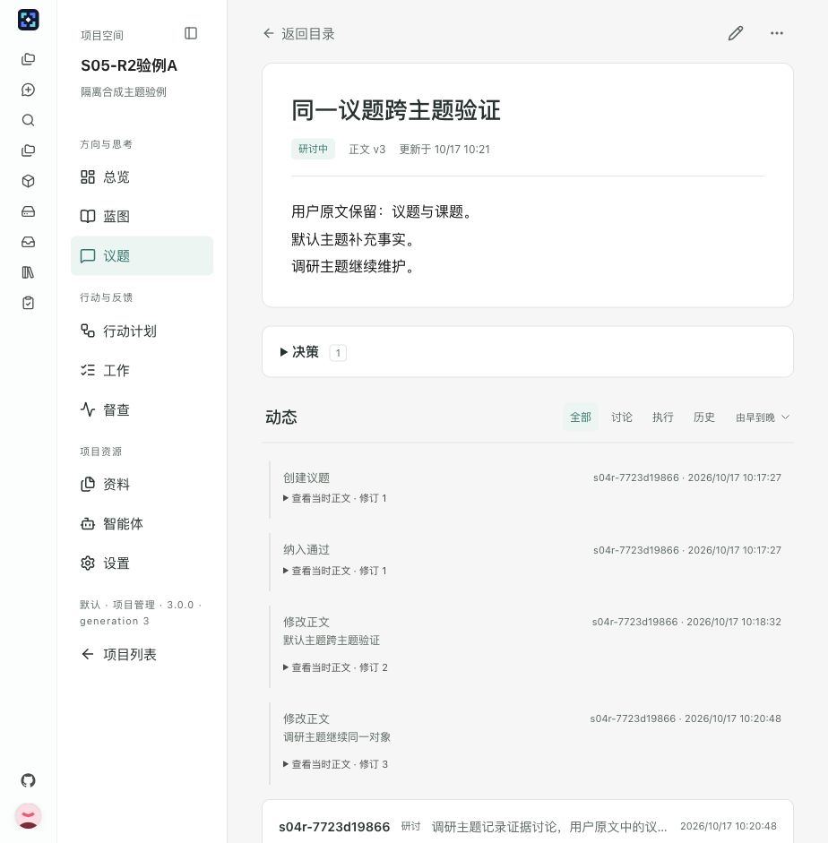
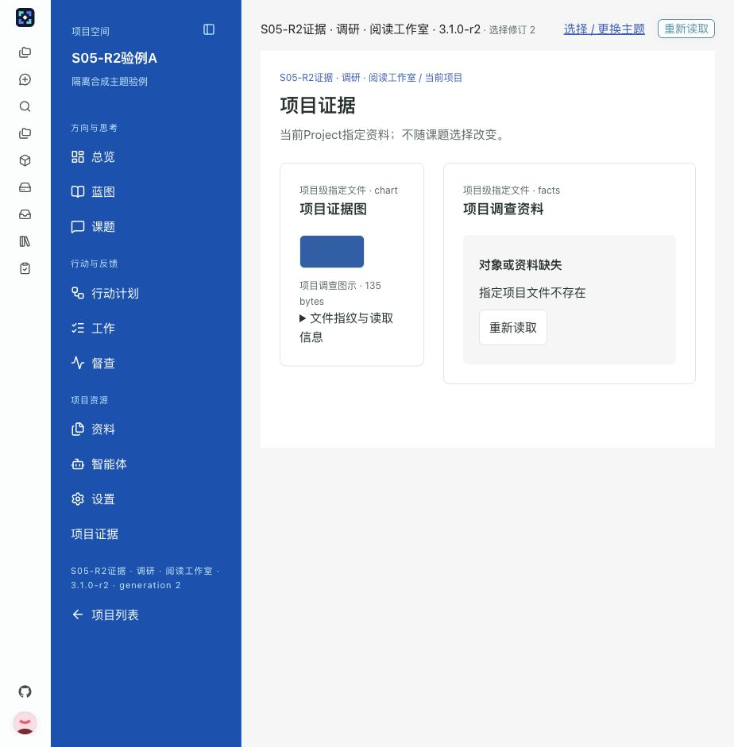

# S05-R2开发交付与人工验证

状态：开发交付待人工验收。当前工作区从c27ebaef接续；本证据只含具名隔离库的合成项目A／B。用户2026-10-17明确直接实施、不画图、不运行全量，验收后自行全量。M1制作链复核及当前限制由[LOG58](../../LOG-DB-001-Dashboard进度基线与执行记录.md#_58-s05-r2真实主题消费与项目证据-2026-10-17)拥有。没有对日常主题库、项目文件或已发布内置ZIP做验证性写入。

## 改动与保留

真实课题目录、详情、编辑／创建、讨论维护、决定历史、关联工作及总览提示消费topicLabel。用户原文原样保留；原ID／状态／权限／revision及审计由原服务维护。双入口、唯一绑定、ABI3三套总览及精简隐藏导航保持。

有权派生新版本增加“项目证据”导航页，复用原JSON／PNG块与布局；资料是Project级，不随所选课题切换。预览、应用用同一真实宿主和资源适配，预览临时映射不写绑定；原弹窗保留拟用版本和路径。默认日常版仍无必填文件，不新增日常内置模板。实际协议及可携边界见[DEV12.3](../../DEV-DB-002-项目主题实施指南.md#_12-3-db-s05-r2-多主题真实表达与双数据联合验证)。

## 人工路径

1. 项目列表→主题管理，或项目设置→选择与预览主题。隔离验例已有“调研证据”与“默认证据”两个我的主题派生版。A最终回到默认3.0.0／generation5，B保留默认证据3.1.0-r2／generation2；三套日常内置字节不变。
2. A选择调研证据3.1.0-r2，填写facts→/facts.json、chart→/chart.png，预览此准确版本。项目仍是默认；进入“项目证据”可读JSON与PNG，正文只读。关闭预览回原弹窗，拟用版及未提交映射保持；显式应用后才切调研，与预览内容一致。未绑定alias应看到明确提示。
3. 进入课题目录，打开“同一议题跨主题验证”：导航、表单及关联提示显示课题，原文“议题与课题”保持。继续编辑、讨论、看决定／历史及关联工作，再切默认，应看到相同正文v3、讨论、已批准决定和工作R2-CASE-000001，历史依据仍为课题修订3／决定版本2。
4. 在项目资料或Workdir更新指定JSON／PNG后，资料页“重新读取”：内容、长度及展开的hash变化；移走文件后显示“指定项目文件不存在”，恢复后重读恢复。此处没有逐课题附件系统。A当前样本24、蓝色PNG；B当前样本99、原调查图，内容独立。
5. 精简主题主导航只保留总览／蓝图／议题。准确工作链接仍打开同一工作，并提供返回主题总览。正文或讨论输入后尝试离开→返回编辑，输入仍在；不以强制销毁丢弃输入。

日常项目没有自动添加证据派生来源；使用时从准确内置版本“创建可编辑副本”，在原受控JSON编辑器声明manifest.files并增加相同有限资料块，保存校验、预览、发布新版本，再按目标项目显式映射／应用。新包内assets仍需完整ZIP；不提供通用设计器或跨实例导出。

## 实际观察

| 场景 | 回读结果 |
| --- | --- |
| 默认→调研证据→默认 | 正常项目入口完成两次显式选择；对象ID不变，正文v1→v2→v3，讨论／批准决定／正式工作及历史保持 |
| 预览与应用 | 预览时A持久默认generation1；应用后调研generation2；同一资料页DOM正文一致；最终切回默认generation3，再验精简generation4，明确恢复默认generation5 |
| 文件更新 | JSON样本12→24，hash变为3f9a9290…2082f；PNG18509→135 bytes，hash变为a1ca9598…00cef；实际字节与服务端hash及磁盘相同 |
| 文件缺失 | 暂移JSON后块状态missing、具体错误；恢复原文件，没有样例兜底 |
| 两项目 | A独立Workdir／默认选择／样本24；B独立Workdir／默认证据选择／样本99；B无A的课题对象 |
| 精简与取消 | 工作主导航隐藏，准确工作仍可打开／返回；取消离开保留讨论输入，验证后清空未发送输入 |

[HTTP／PG／文件及原ZIP独立回读](http-pg-files.json)由只读project_theme_r2_evidence.py --verify生成。准备模式通过原HTTP制作服务有权复制／编辑／发布两个新来源；验证模式重读绑定行、真实业务行、工作冻结来源、Workdir文件和不可变ZIP，不把准备动作的返回当证据。

其他截图：updated-evidence为更新后的两份hash；project-b-evidence为B独立资料；focus-exact-work为隐藏导航下准确工作与返回；cancel-draft为取消离开保留输入；research-history为原批准历史；evidence-fingerprint为指纹换行检查。unbound-candidate-preview为未绑定C项目的准确草稿revision2预览，资料缺映射明确unbound、generation仍0。截图均来自真实页面，未绘制关系图。

## 未验与限制

未运行前后端全量unit、全量integration／E2E；没有拆批提前跑完全量。人工验收、跨实例S06迁移、生产数据、所有控件组合、暗色及375／768／1024完整响应式矩阵未验。一次viewport能力尝试后实际DOM宽仍924，未把该截图标成375通过。保留原SSR测试的路由／未注册控件／Markdown sanitize提示；真实浏览器正文正常，UI截图仅为实际尺寸观察。

项目文件预览按alias读取当前字节，不固定文件快照；只有准确包引用及revision固定。刷新才反映文件变化。预览正文inert使办理／内部资料控件不可操作，项目主导航及结束预览可操作；需要核对展开指纹时在正式资料页进行。服务端最终授权独立于只读界面。JSON／PNG之外的新格式、逐课题附件、任意代码执行均未扩展。
