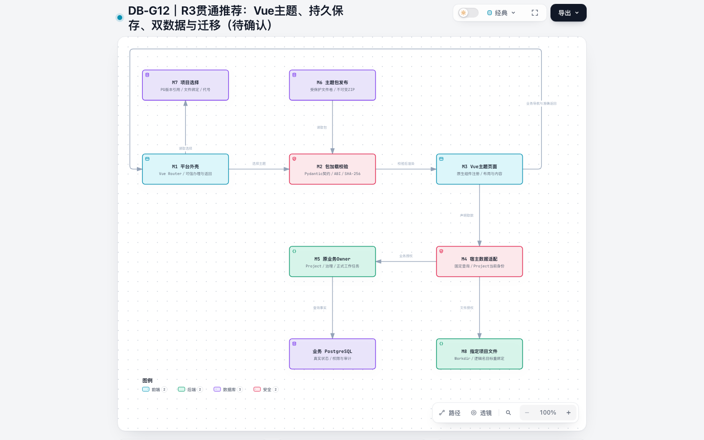
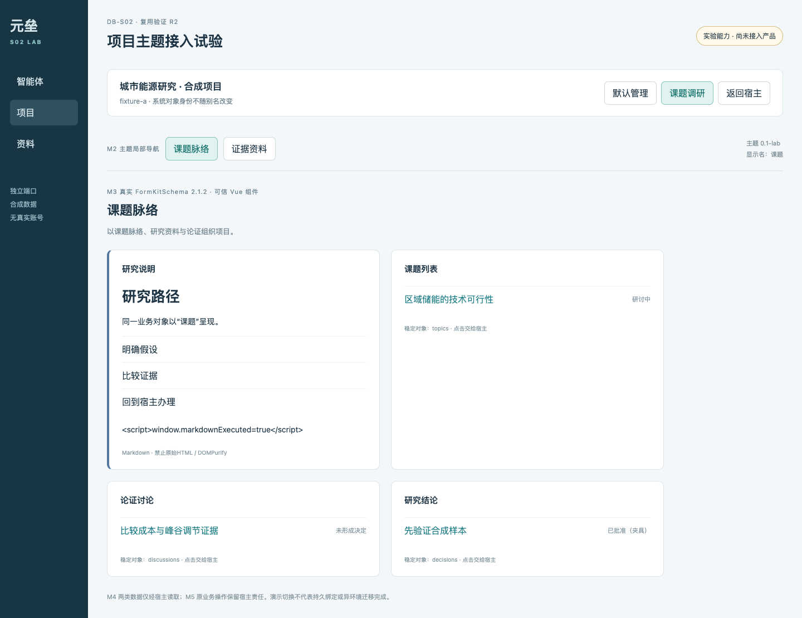
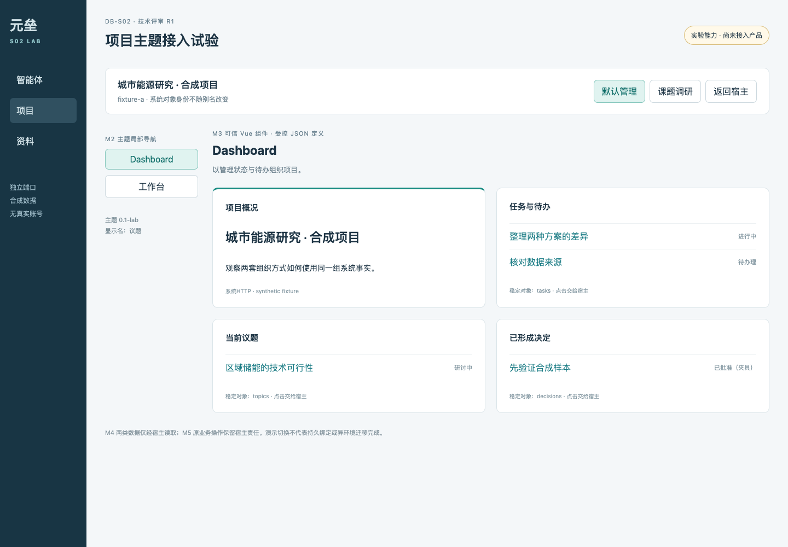
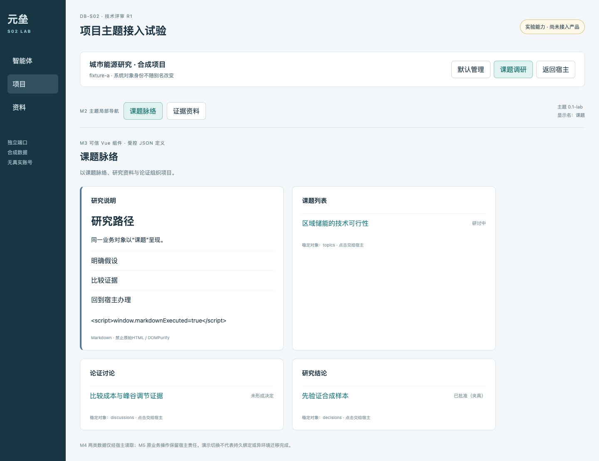
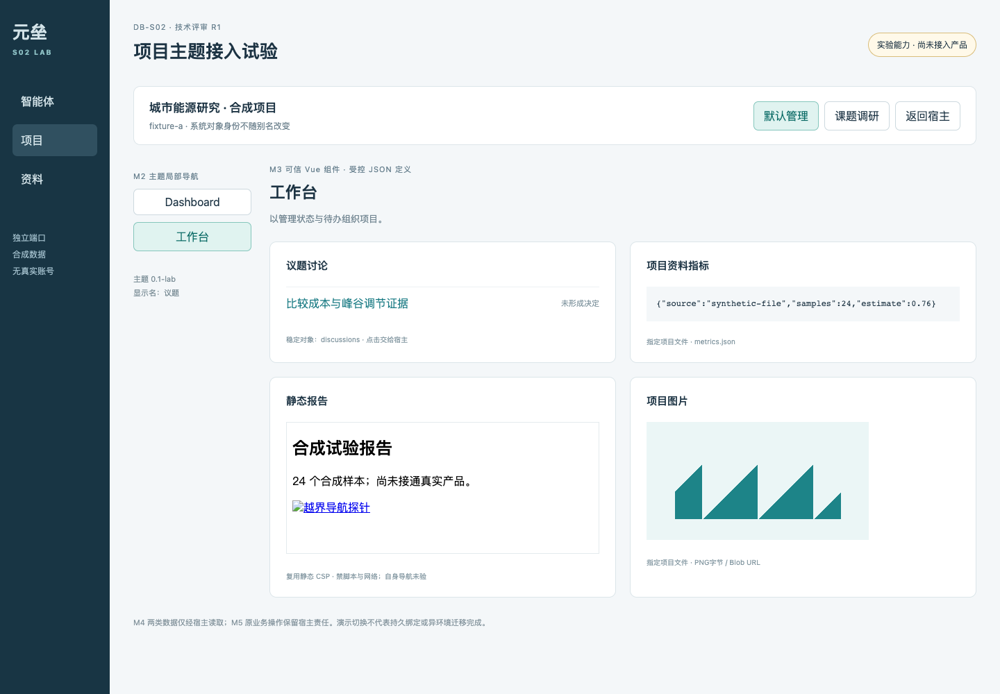
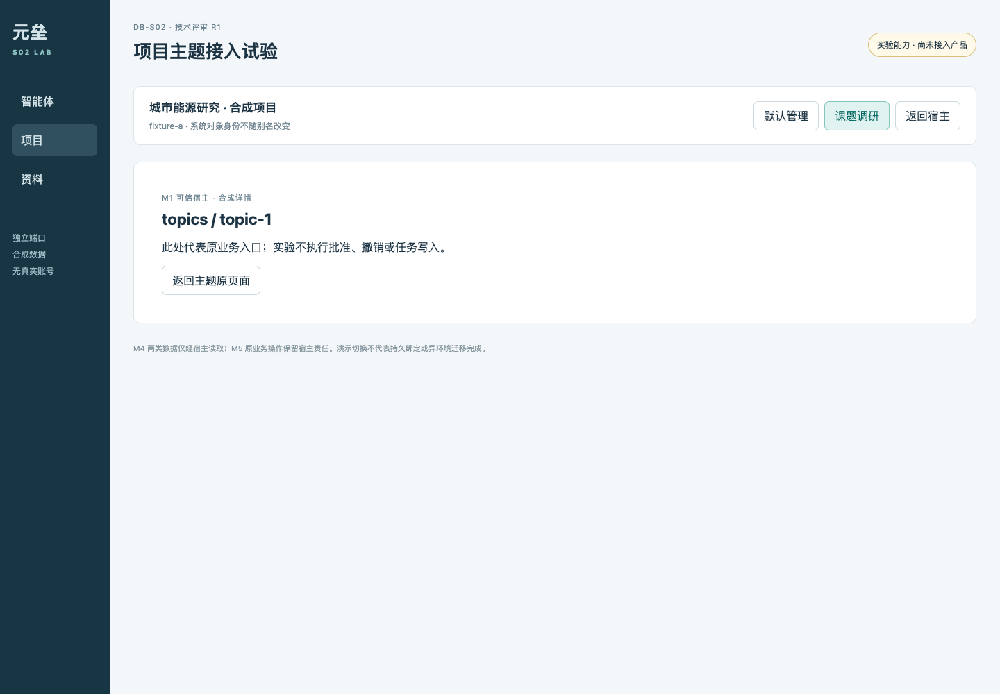
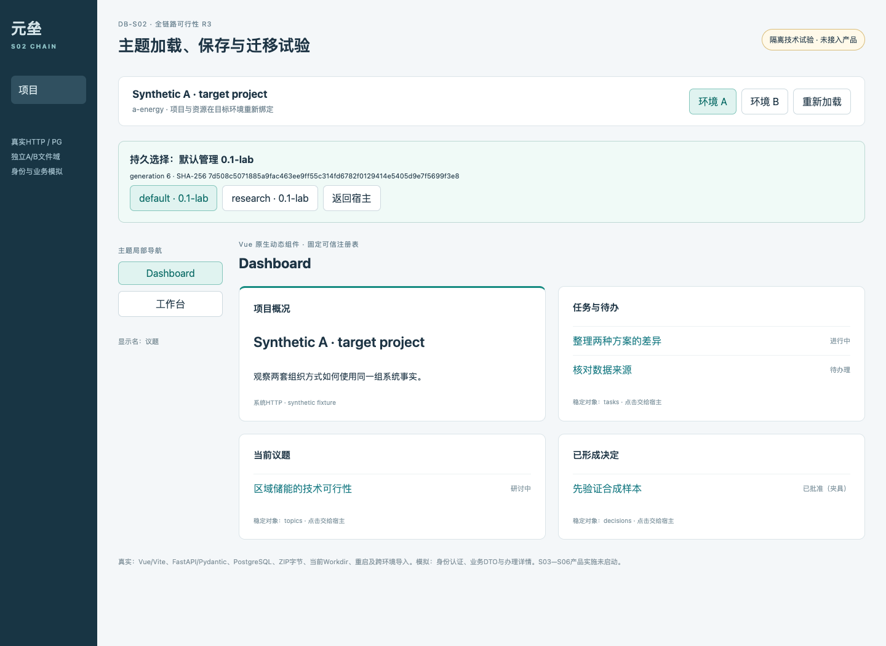
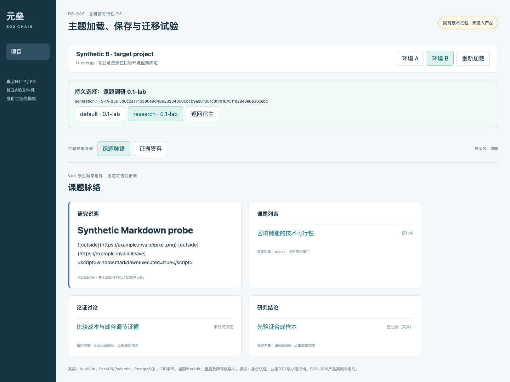
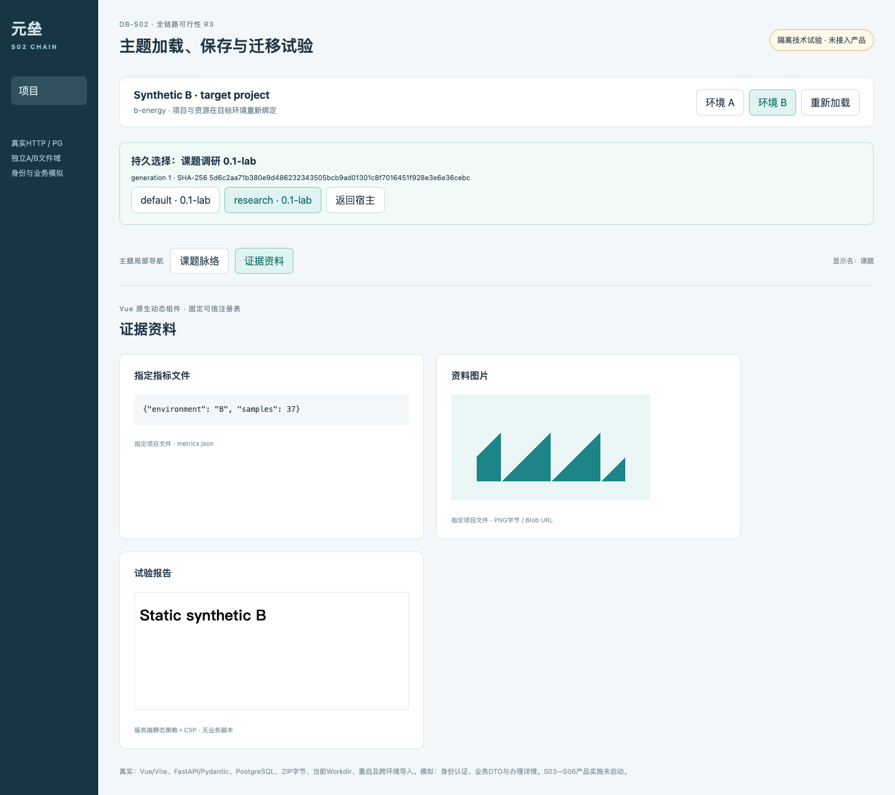

# SYS-DB-003｜S02项目主题技术调研与最小接入试验 R3（历史归档）

> 冻结研究材料，不作为当前任务或产品事实。2026-10-12用户已采纳R3；当前执行依据是[DEV-DB-002](../../DEV-DB-002-项目主题实施指南.md)，确认与完成状态见[LOG](../../LOG-DB-001-Dashboard进度基线与执行记录.md)。下文“待确认”、旧命令与试验限制均保留历史语境。

读者：用户与专项Reviewer。性质：SYS-DB-001的研究附件，2026-10-11开始；2026-10-12补充候选优选、明确路线及S03—S06贯通证据；技术方向待用户确认，阶段验收待用户判断。任务边界由[DEV第4节](../../DEV-DB-001-Dashboard开发任务与实施约束.md)拥有，实际结果及确认由[LOG](../../LOG-DB-001-Dashboard进度基线与执行记录.md)拥有。本文不启动S03—S07、协作接入或Andon。

## 1. 先看整体：现状与职责

<a href="图解/12-s02-20261011/theme-route-r3.html" target="_blank" rel="noopener">DB-G12｜Vue加载、持久保存、双数据与迁移（R3推荐待确认）</a>。图示候选设计，不表示产品已经接线。r3-candidate、finalize和browser-check回执同目录保存；四项gate通过，1440浅色截图已目视检查，返回线沿外圈，主路径和标签可辨。图回答职责；下方实际试验页面回答布局与组织方式。



| 模块 | 解决的问题与默认内容 | 点击及离开路径 | 事实与限制 |
| --- | --- | --- | --- |
| M1 平台外壳 | 保持当前项目、一级导航、全局返回和加载错误入口 | 切主题、打开准确业务对象、回原主题页 | 身份与授权归宿主；主题不能切换账号或注入任意返回URL |
| M2 加载校验 | 版本、来源、组件词汇与逻辑数据需求 | 校验通过后显示；失败显示原因及可信入口 | 生成包属于不可信输入；指纹只证明字节一致 |
| M3 主题页面 | Dashboard、工作台、议题/课题、讨论、决定、任务的导航与布局 | 局部页面切换，业务动作交M5 | 显示名不改变对象类型；HTML、Markdown、图片是内容块 |
| M4 宿主数据入口 | 分别读取系统对象与指定文件，表达空/错/来源 | 有效对象导航；文件只按逻辑别名请求 | 后端仍重验用户、项目、对象与文件范围；主题不持有Token |
| M5 业务与办理 | 原service/repository中的状态、讨论、决策和任务操作 | 原业务页面办理后准确返回 | 批准/撤销/接受等仍由原Owner执行；S02不增加写能力 |
| M6 主题文件包 | 页面定义、资源、依赖、来源、版本和指纹 | 编辑候选、预览、形成新版本 | 公共发布资源与项目候选隔离；受保护ZIP＋PG绑定已确定；S04落地产品管理 |
| M7 项目选择 | 当前项目启用哪个包的哪个版本 | 选择后保存绑定；导入先待绑定 | 绑定属于项目身份；同Workdir不共享启用状态 |

当前源码基线为`d2bf7134f8db227f64360be2b5bea848555747ca`，分支`codex/dashboard`，R1开始时工作树干净，R3开始时已有两轮研究改动；已包含`c0cd0c85`和`d2bf7134`样式修订。没有沿用旧提交判断能力。S01用户验收为76/100“基本能用，审美较差”，审美改进用于后续设计；S02的实验页面不构成重新开展S01。

| 当前真实Owner | 核对结果 | 对候选的约束 |
| --- | --- | --- |
| Vue入口与依赖（`web/package.json`）、Vite配置（`web/vite.config.js`）、路由（`web/src/router/index.js`） | Vue 3.5.41、Vite 8.2.2、plugin-vue 6.0.8来自当前依赖；路由静态声明并懒加载Vue页，开发代理指向API | 原生组件有真实落点；Vite构建不能把任意运行时上传SFC自动变成安全组件 |
| 项目概览（`web/src/views/ProjectDashboardView.vue`）、静态壳（`web/src/utils/dashboardFrame.js`）、Dashboard服务（`backend/package/yuxi/services/project_dashboard_service.py`） | 可信管理概览与业务大屏分开；大屏是`/dashboard/index.html`单文件，revision/hash对账；后端拒绝script/meta/外部href，iframe空sandbox及CSP禁止网络 | 现有静态页不提供跨页或动态通信；不能把它声称为主题运行时 |
| 项目管理（`web/src/views/ProjectsView.vue`）、项目设置服务（`backend/package/yuxi/services/project_settings_service.py`） | 公共/专属主题界面仍占位，按钮禁用；icon/slug真实实现 | 外观深浅色store与项目主题是不同概念；源码没有可用主题库及项目theme binding |
| 治理API（`web/src/apis/governance_board_api.js`）、工作API（`web/src/apis/project_work_api.js`）、督查service（`backend/package/yuxi/services/inspection_board_service.py`） | 项目、议题、评论/讨论、决定及工作任务已有业务入口；概览聚合正式事实并构造业务路径 | 要分别选对Owner，治理工作建议与正式工作任务不能按同名task随意合并 |
| Viewer API（`web/src/apis/viewer_filesystem.js`）、文件service（`backend/package/yuxi/services/viewer_filesystem_service.py`）、授权Workdir（`backend/package/yuxi/services/workdir_service.py`）、filesystem（`backend/package/yuxi/workspace/filesystem.py`） | Viewer经thread_id授权解析到Project Workdir，拒绝runtime路径，文件原语拥有no-follow | 无对话线程的项目主题需要项目级授权接入；不能伪造线程或把宿主路径传给浏览器 |
| Markdown预览（`web/src/utils/markdown_preview.js`） | markdown-it、DOMPurify及独立HTML/SVG预览职责已有实现 | 可复用呈现职责，但主题包不自动继承该渲染器所有标签与格式能力 |

Compose日常服务仅做只读状态核对，实验没有修改它们的配置、账号或项目。R1/R2与R3小试位于独立实验目录，使用现有web依赖/API镜像及专用PG，不改变产品路由/Schema；R3为Vue5192与独立HTTP5190/5191。

## 2. 问题、候选筛选与实际采用者

待回答的核心问题是：表达自由度是否值得新增构建与权限面，多页面组织是否需要执行用户代码，文件内容与业务操作能否分责，以及导出包能否脱离原身份和路径。先用以下筛选证据判断案例与模块的适用范围，再读具体加载和迁移机制。没有部署完整候选平台。

### 2.0 候选怎样进入比较：覆盖、证据与淘汰依据

研究范围为2026-10-12可核验的20个公开源码候选和3个商业对照。原三个入口按机制差异选取，属于机制抽样，没有完成广泛优选；其声誉和可借鉴性不能代替元垒技术栈的适配论证。当前评审先看本节筛选，再看具体案例与试验。主题范围、业务Owner和DB-G12关系保持不变；R2重新比较M2/M3实现来源；R3第5节给出确定推荐及贯通试验证据，R1小试保留为基准。

筛选围绕五个实际问题：能否覆盖多页业务主题；能否复用当前Vue 3/Vite及FastAPI而少引入运行体系；模块是否可独立使用及合法分发；生成输入的执行权限与数据边界是否可控；维护与迁移是否有可追溯事实。依次检查官方文档/README、仓库与发行元数据、关键源码/包声明、目标未知的小试。没有用总分掩盖不适配项，也没有把所有候选都描述成深度验证完成。

采用证据分为：使用方官方集成说明（可证明具名平台实际采用）、具名客户案例（厂商发布，可证明报道的部署场景）、厂商自述/示例（可证明其声称及展示）、仓库关注度（不能证明部署或质量）。GitHub stars/forks、pushed_at和最新列出release已直接读取公开API，保存于checkout文件`图解/12-s02-20261011/candidate-survey.json`；首轮README/许可证/包读取及失败保留在selection-first-screen，重点源码的commit、字节数及SHA-256保留在selection-source-evidence。pushed_at不等于有效维护，最新列出release可能是预发布；JupyterLab、Budibase和Dash的预发布不作为生产选型版本。

下表成本是相对于当前元垒的集成类别判断：低为库级接入及适配；中为物料、样式、受控协议与构建适配；高为第二前端/后端运行体系、会话、权限和运维接入。它们不是已测工时。每个候选的公开仓库/版本是证据入口，源码抽查深度由上述回执区别。

| 候选与核验样本 | 与元垒的匹配、能复用什么 | 限制、成本及当前筛选结果 |
| --- | --- | --- |
| [Grafana v13.2.3](https://github.com/grafana/grafana/releases/tag/v13.2.3) | 成熟Dashboard/应用插件、数据源依赖与导出重绑定 | React及Grafana宿主；整平台AGPL-3.0。高；保留架构参照，整套嵌入不优先 |
| [Appsmith v2.5.0](https://github.com/appsmithorg/appsmith/releases/tag/v2.5.0) | 多页业务DSL、模型/事件、应用导入导出 | React与其服务端/权限体系；Apache-2.0入口不能覆盖所有商业包。高；保留业务页面参照 |
| [JupyterLab v4.6.4](https://github.com/jupyterlab/jupyterlab/releases/tag/v4.6.4) | 文件模型、MIME、文档插件与工作区迁移 | Lumino工作台及Jupyter服务；BSD-3-Clause。高；保留文件职责参照 |
| [Directus v12.5.0](https://github.com/directus/directus/releases/tag/v12.5.0) | Vue 3模块/路由/Panel与统一宿主API，是更贴近的壳层参照 | SDK MIT，平台本体MSCL-1.0-GPL，模块仍依赖Directus注入与私有视图。中至高；进入重点源码比较 |
| [TinyEngine v2.11.0](https://github.com/opentiny/tiny-engine/releases/tag/v2.11.0) | Vue Schema、物料与可独立安装的Vue出码器；MIT | 完整设计器、运行时表达式和配套服务多于本需求；中至高。进入可直接复用小试 |
| [amis 6.13.0](https://github.com/baidu/amis/releases/tag/6.13.0) | 完整JSON业务页面；SDK可嵌入Vue宿主；Apache-2.0 | React运行时、样式与API/表达式能力需约束；中。保留完整Schema渲染器备选，不因React直接淘汰 |
| [Alibaba LowCodeEngine v1.3.2](https://github.com/alibaba/lowcode-engine/releases/tag/v1.3.2) | 低代码协议、物料及设计器；MIT | 默认React物料；[官方Vue出码答复](https://lowcode-engine.cn/site/docs/faq/faq018)要求兼容物料及定制插件；另有[官方列出的社区Vue renderer](https://lowcode-engine.cn/site/docs/faq/faq017)，不能因默认React一概淘汰。中至高；完整设计器暂后排，社区独立renderer保留未验证备选 |
| [Formily v2.3.6](https://github.com/alibaba/formily/releases/tag/v2.3.6) | Vue绑定、表单Schema、状态与联动；MIT | 表单范围；现有Ant Design Vue 4物料兼容尚未跑通；中。表单模块备选，不能单独代替多页主题 |
| [JSON Forms v3.8.0](https://github.com/eclipsesource/jsonforms/releases/tag/v3.8.0) | Vue 3绑定、JSON Schema/AJV与UI Schema；MIT | 官方Vue renderer主要vanilla/Vuetify，现有Ant Design需适配；低至中。标准化表单备选 |
| [FormKit v2.1.2](https://github.com/formkit/formkit/releases/tag/v2.1.2) | 原生Vue组件Schema，支持注册自有组件；MIT核心 | 原生Schema允许任意DOM与组件解析，不能直接把生成包交给它；低。进入真实库级渲染小试，采用面证据有限 |
| [form-create v3.3.0](https://github.com/xaboy/form-create/releases/tag/v3.3.0) | Vue 3及Ant Design Vue适配、JSON表单；MIT核心 | 表单编辑/提交职责，需要约束函数/事件和验证具体依赖；低至中。表单优先候选，非完整主题运行时 |
| [GrapesJS v0.23.6](https://github.com/GrapesJS/grapesjs/releases/tag/v0.23.6) | 框架独立的HTML/CSS编辑、项目JSON与页面；core BSD-3-Clause | 业务组件、动作与资源边界要另外接入；中。静态页面编辑备选；商业Studio SDK不等于core |
| [Puck v0.23.0](https://github.com/puckeditor/puck/releases/tag/v0.23.0) | 自有组件注册、JSON页面与编辑器；MIT | React组件不能直接消费Vue物料；中至高。同类机制参照，Vue条件下后排 |
| [ToolJet v3.20.243-lts](https://github.com/ToolJet/ToolJet/releases/tag/v3.20.243-lts) | 完整内部工具、查询与页面搭建 | React/Node独立平台，AGPL-3.0入口及商业功能边界；高。与Appsmith重复的整平台路线，暂不部署 |
| [Budibase v3.49.0-cloud.3（预发布）](https://github.com/Budibase/budibase/releases/tag/v3.49.0-cloud.3) | 内部应用、页面及自动化 | Svelte独立体系；官方说明逐包许可，整体GPLv3、付费包BSL；高。保留对照，不能称整体MIT |
| [FlowFuse Dashboard v1.33.0](https://github.com/FlowFuse/node-red-dashboard/releases/tag/v1.33.0) | Vue 3/Vuetify页面与模板、Node-RED消息数据；Apache-2.0 | 业务模型属于Node-RED flows，需引入该执行体系；高。实时流仪表盘条件下再考虑 |
| [Streamlit 1.65.0](https://github.com/streamlit/streamlit/releases/tag/1.65.0) | Python快速多页数据应用、iframe呈现；Apache-2.0 | 独立会话/服务；公开Cloud embed说明不支持私有app嵌入，不能泛化至所有自托管；中至高。独立研究工具备选 |
| [Panel v1.9.4](https://github.com/holoviz/panel/releases/tag/v1.9.4) | Python数据视图，官方支持FastAPI接入；BSD-3-Clause | 该FastAPI能力仍被官方标为experimental，Bokeh会话/通信与Vue主题不同；中至高。数值研究工具备选 |
| [Gradio gradio@6.30.0](https://github.com/gradio-app/gradio/releases/tag/gradio%406.30.0) | Python模型/工具界面，具备挂载到FastAPI的代码入口；Apache-2.0 | 生成Python和服务端执行授权仍需隔离，整体业务页/视觉组织不等于工具demo；中至高。AI工具子页面备选 |
| [Dash v4.5.0rc0（预发布）](https://github.com/plotly/dash/releases/tag/v4.5.0rc0) | Python回调与数据分析界面；MIT核心 | React/Flask应用或商业嵌入体系，须另接会话与权限；高。数据分析子应用备选 |

商业对照另看[Retool嵌入机制](https://docs.retool.com/classic-apps/concepts/share-externally/embed)、[Builder.io Vue页面SDK](https://www.builder.io/c/docs/integrating-builder-pages)、[Storyblok Vue SDK](https://www.storyblok.com/docs/libraries/js/vue-sdk)。Retool有[具名客户列表](https://retool.com/customers)，但采用整平台/嵌入会引入第二权限和商业依赖；Builder/Storyblok原生Vue SDK值得比较，却不等于其编辑、内容管理和发布服务可无账号完整自托管。三者本轮只核对官方能力与服务边界，未测试租户、费用、导出或私有部署，不据此断言一定不可用。此处比较的是现有产品方向，不把商业服务默认为用户禁止项。

LowCodeEngine另沿官方Vue画布FAQ追到[KNXCloud社区源码](https://github.com/KNXCloud/lowcode-engine-vue)。固定commit fbd35bb56fe574aec4e249cda6681b1654df4dd9的README与指纹见lowcode-vue-route.json：提供Vue renderer/画布适配、物料映射、VueRouter接入及异步Suspense要求。示例采用Vue3.2.47和CDN，当前Vue3.5/Vite8兼容、执行表达式边界、维护和生产采用仍未实测；它属于已有LowCodeEngine家族的一条额外路径，不另算第21个完整平台，更不能从默认React推出Vue无解。

#### 原三个是否值得研究，是否很多平台采用

| 案例 | 采用证据及可支持的结论 | 值得借鉴的具体机制 | 不能从证据推出的结论 |
| --- | --- | --- | --- |
| Grafana | [AWS官方Managed Grafana](https://docs.aws.amazon.com/grafana/latest/userguide/)提供实际平台采用证据；[2025-09-30官方公告](https://grafana.com/press/2025/09/30/grafana-labs-surpasses-400m-arr-and-7000-customers-gains-new-investors-to-accelerate-global-expansion/)报告7,000余组织客户，这是厂商口径；[GitLab监控文档](https://docs.gitlab.com/administration/monitoring/prometheus/)推荐可选Grafana，只算支持性说明 | 壳、插件、数据源和可携带Dashboard分责，有大规模产品实践 | 7,000组织都采用同一种插件沙盒；元垒应复制React运行时；所有客户已独立核验 |
| Appsmith | [Strapi内部Cloud Admin案例](https://www.appsmith.com/case-studies/strapi)、[GSK等具名客户索引](https://www.appsmith.com/customers)、[Allround约90用户案例](https://www.appsmith.com/case-studies/allround)，均为厂商发布的具名部署报道 | 多页业务定义、宿主数据模型及显式事件、应用迁移 | 许多其他平台嵌入Appsmith渲染器；有独立统计证明市场占有率；Vue直接兼容 |
| JupyterLab | [AWS SageMaker JupyterLab](https://docs.aws.amazon.com/sagemaker/latest/dg/studio-updated-jl.html)、[Google官方Workbench源码指南](https://github.com/GoogleCloudPlatform/generative-ai/blob/main/setup-env/README.md)明确实际工作台采用 | 文件内容、插件代码、UI工作区与后端数据分别管理 | Notebook、Colab、JupyterLite都等同JupyterLab服务；workspace导出搬走账号、文件和kernel |

三者都具有值得对比的证据；Grafana与JupyterLab有使用方平台证据，Appsmith有多个具名部署报道。原三者覆盖了机制差异，但Vue原生适配覆盖不足。当前核心比较增加Directus与TinyEngine，原三者继续作专长参照；FormKit、amis、form-create和JSON Forms进入模块复用比较。对“主流”的结论止于上述可核验采用范围；没有市场份额或独立部署统计时不写“行业最佳/普遍采用”。有限组件模式在多个成熟产品中存在，不证明元垒拟议的具体受控子集已有同等采用规模。

#### 维护与证据缺口怎样影响排序

候选API快照中，LowCodeEngine最近push为2025-03-10、Formily为2025-06-21、amis为2026-03-18；相较当前持续变动仓库，它们增加升级与问题响应的不确定性，不能仅凭stars抵消，也不能仅凭push日期判定停更。FlowFuse Dashboard只有355 stars，仍因Vue 3实际实现进入初筛；TinyEngine、FormKit和JSON Forms未取得与Grafana相当的多平台独立采用证据，不能包装成同等规模的主流。当前Vue接入价值来自源码、包边界及实际小试，而非声誉借用。

原案例同时复核较新发行：Grafana v13.2.3、Appsmith v2.5.0、JupyterLab稳定v4.6.4；R1冻结样本仍有明确历史定位。当前源码读取回执是original-cases-current-evidence：Grafana旧plugin_loader路径404，经当前目录定位并成功读取[新importer Owner](https://github.com/grafana/grafana/blob/v13.2.3/public/app/features/plugins/importer/importPluginModule.ts)，确认当前SystemJS及条件sandbox装配；其余成功路径分别核对当前壳/导出、widget/导入导出与文件/Contents实现。所有网络失败原样保留，未当成源码证据。

研究固定实现样本，不宣称这些是最新发行版：Grafana v11.6.0（`d2fdff9ee4d75c74bfd3a97c18a0b8e4d029f06e`）、Appsmith v1.66（`535792f96afc978a75c053e037caeabc9a5d833b`）、JupyterLab v4.4.10（`a4e885ce990eedc5e71c81fbc0122da7c34d6ba4`）。官方GitHub tag已解引用到commit；逐文件读取、URL、字节数与hash见源码证据（checkout文件`图解/12-s02-20261011/source-evidence.json`）。当前官方文档与截图单独标来源，不将其版本套到冻结源码。

### 2.1 Grafana：组件应用与声明式Dashboard并存

应用插件用`plugin.json`声明导航页面，`AppPlugin`提供React根组件，`PluginPage`接入平台页面壳。源码loader使用SystemJS加载构建产物，可带integrity，并在符合registry条件时走frontend sandbox；不能笼统声称所有插件天然隔离。[官方应用教程](https://grafana.com/developers/plugin-tools/tutorials/build-an-app-plugin)、[固定版本PluginPage](https://github.com/grafana/grafana/blob/v11.6.0/packages/grafana-runtime/src/components/PluginPage.tsx)、[固定版本loader](https://github.com/grafana/grafana/blob/v11.6.0/public/app/features/plugins/plugin_loader.ts)。

通信依赖宿主runtime服务和数据源机制；Dashboard JSON表达面板、查询及布局，app自定义页仍是代码。插件的构建资源和Dashboard定义分别发布、维护，JSON导出不携带插件实现。跨实例导出需要匹配插件及数据源：`DashboardExporter`移除本实例id，整理依赖并把数据源uid转成导入输入；这支持“可携带结构，目标环境重绑定依赖”的借鉴。[Exporter源码](https://github.com/grafana/grafana/blob/v11.6.0/public/app/features/dashboard/components/DashExportModal/DashboardExporter.ts)、[官方导出说明](https://grafana.com/docs/grafana/latest/visualizations/dashboards/share-dashboards-panels/)。

真实页面依据为[官方Dashboard截图及说明](https://grafana.com/docs/grafana/latest/fundamentals/dashboards-overview/)；[公开演示](https://play.grafana.org/)在本机浏览器超时，未记录成成功页面。截图只能支持组织与外观判断，不能证明插件权限。对元垒最有价值的是“平台壳＋多页应用＋逻辑数据源分离”；直接搬入Grafana/React runtime会新增双框架和插件服务，当前收益不足。


### 2.2 Appsmith：页面DSL、宿主模型与可执行widget

内置widget由页面定义组合；CustomWidget保存HTML/CSS/JS并用`srcDoc`加载。固定版本组件监听`event.source === iframeWindow`，通过postMessage握手传model/ui/mode/theme，接收模型更新、事件和高度；它的sandbox允许脚本、表单和弹窗，另有关闭sandbox的分支。这个协议证明隔离页面需要宿主桥，但不能原样作为元垒安全契约。[CustomWidget组件源码](https://github.com/appsmithorg/appsmith/blob/v1.66/app/client/src/widgets/CustomWidget/component/index.tsx)、[widget定义与编辑源码](https://github.com/appsmithorg/appsmith/blob/v1.66/app/client/src/widgets/CustomWidget/widget/index.tsx)。

官方`appsmith.model`、`updateModel`、`onModelChange`及`triggerEvent`让widget通过宿主数据和事件交互。页面/动作/数据源按应用资源维护，导出形成版本化ApplicationJson/ArtifactExchangeJson，ExportService委托资源sanitizer清理导出内容，ImportService校验结构并在目标workspace权限上下文导入。不能仅据JSON可导出断言任何导出模式都不含敏感配置；元垒应独立限定可导出字段。[官方Custom文档](https://docs.appsmith.com/reference/widgets/custom)、[Export源码](https://github.com/appsmithorg/appsmith/blob/v1.66/app/server/appsmith-server/src/main/java/com/appsmith/server/exports/internal/ExportServiceCEImpl.java)、[Import源码](https://github.com/appsmithorg/appsmith/blob/v1.66/app/server/appsmith-server/src/main/java/com/appsmith/server/imports/internal/ImportServiceCEImpl.java)、[官方迁移说明](https://docs.appsmith.com/advanced-concepts/more/backup-restore)。

真实截图来自官方Custom Widget Builder；官方[Data Grid示例](https://app.appsmith.com/app/data-grid/page1-6597ff5559aa5450e0eb4eb9)在本机浏览器超时。值得借鉴“有限组件＋数据模型＋显式事件”，不引入Appsmith完整编辑器、任意JS表达式或其权限服务。所建议的元垒受控定义是本地新试验，不是假称已接入Appsmith。


### 2.3 JupyterLab：文件模型、MIME与工作区状态

文档registry把文件类型映射到viewer/editor；Contents服务通过`api/contents`读取、保存和下载文件，模型与视图分离。HTML文件viewer用Blob URL装载iframe，区分trusted/untrusted并解析相对资源；MIME HTML输出还会按trust执行净化或脚本处理，不能把文件HTML与cell HTML混成一种信任机制。[官方格式说明](https://jupyterlab.readthedocs.io/en/4.4.x/user/file_formats.html)、[HTMLViewer源码](https://github.com/jupyterlab/jupyterlab/blob/v4.4.10/packages/htmlviewer/src/widget.tsx)、[MIME渲染源码](https://github.com/jupyterlab/jupyterlab/blob/v4.4.10/packages/rendermime/src/renderers.ts)、[Contents源码](https://github.com/jupyterlab/jupyterlab/blob/v4.4.10/packages/services/src/contents/index.ts)。

扩展是拥有宿主能力的插件，prebuilt扩展支持独立构建发布，不能把它等同于安全的用户文档。文件保存在Contents后端，workspace保存UI状态，扩展资源另行安装。workspace import/export携带布局及文件引用，不自动迁移文件、扩展、kernel和服务身份；目标环境需匹配路径与依赖。[扩展开发](https://jupyterlab.readthedocs.io/en/4.4.x/extension/extension_dev.html)、[Workspace迁移格式](https://jupyterlab.readthedocs.io/en/4.4.x/user/workspaces.html)。

官方Open With截图是已可访问的真实页面证据；公开[Try Jupyter](https://jupyter.org/try-jupyter/lab/)是JupyterLite，在本机只加载出Loading页，不作为JupyterLab服务端协议运行证据。元垒可借鉴“文件类型选择受控渲染器，布局与文件分别迁移”，无需部署kernel或Lumino工作台。


外部页面访问失败和最终URL保留在访问回执（checkout文件`图解/12-s02-20261011/case-pages.json`）。源码、官方截图与演示访问是不同证据，未运行这些平台的部署、导出导入或权限测试。

### 2.4 Directus：Vue宿主、扩展模块与Dashboard配置

Directus v12.5.0固定commit为`4f77933bf9551cac6b289576078783e189b8f4e3`。官方[模块扩展](https://directus.com/docs/guides/extensions/app-extensions/modules)用Vue 3组件及Vue Router式routes接入模块导航，`private-view`给出宿主导航、header、sidebar及content slots；[Panel扩展](https://directus.com/docs/guides/extensions/app-extensions/panels)通过入口对象注册Vue组件与options。模块、Dashboard Panel和仅改变颜色/字体的Custom Theme分别有职责，不能把其“Theme”直接当作元垒多页项目主题。

源码[extensions-sdk入口](https://github.com/directus/directus/blob/v12.5.0/packages/extensions-sdk/src/index.ts)导出useApi/useStores/useItems和defineModule/definePanel；[真实Dashboard页面](https://github.com/directus/directus/blob/v12.5.0/app/src/modules/insights/routes/dashboard.vue)连接其collection、panel和权限composables；[dashboard字段](https://github.com/directus/directus/blob/v12.5.0/packages/system-data/src/fields/dashboards.yaml)与[panel字段](https://github.com/directus/directus/blob/v12.5.0/packages/system-data/src/fields/panels.yaml)体现数据中保存布局、类型与options，而扩展Vue代码另由包构建发布。数据通信由Directus宿主提供，组件不能仅凭拿到SDK就获得元垒FastAPI或权限能力。

采用依据为[Prusa3D具名案例](https://directus.com/resources/prusa3d)和[公开扩展市场](https://directus.com/extensions)，分别是厂商发布的部署报道及第三方生态活动，不推导具体模块的安装规模。实际界面见官方模块与Panel文档中的真实页面示例；本轮未运行Directus服务端或导入迁移。模块迁移需携带构建后的扩展和配置，并重建宿主版本、collection/API与身份依赖，具体配置迁移仍依Directus契约，不能直接导入元垒。

复用判断：壳的slots、模块注册、逻辑资源与API注入十分贴近元垒；直接导入其应用页面会牵入全局组件和store，需改写宿主依赖。固定版本[SDK许可证](https://github.com/directus/directus/blob/v12.5.0/packages/extensions-sdk/license)为MIT；[平台本体许可证](https://github.com/directus/directus/blob/v12.5.0/license)为MSCL-1.0-GPL，包含竞争用途限制及未来GPL条款，不能把整平台宣传成MIT或继续套用旧BSL事实。模块级适配成本中，整平台引入成本高；若选择独立CMS及其权限/存储体系成为产品目标，再重评整平台接入。当前作为最接近的Vue平台参照，不复制本体。

### 2.5 TinyEngine：Vue低代码与直接出码复用

TinyEngine v2.11.0固定commit为`22104508d06c36fc0e301758176e2a5cd4897d8c`，MIT。它的优势是Vue物料、Schema、页面/区块与可独立安装的[Vue出码模块](https://github.com/opentiny/tiny-engine/blob/v2.11.0/packages/vue-generator/README.md)，不是要求元垒自行复刻一套设计器。官方[出码说明](https://docs.opentiny.design/tiny-engine/dev/code-output-function/code-output-overview-and-usage.html)明确Schema到可审阅Vue源代码、部分页面接入既有项目和生产不带设计器runtime的路径；这构成与运行时Schema路线不同的真实备选。

包[canvas声明](https://github.com/opentiny/tiny-engine/blob/v2.11.0/packages/canvas/package.json)要求Vue ^3.4.15及TinyVue系列/vue-i18n；[runner](https://github.com/opentiny/tiny-engine/blob/v2.11.0/packages/canvas/render/src/runner.ts)读取父文档、派发事件、装载scripts/styles并创建Vue应用；[parser](https://github.com/opentiny/tiny-engine/blob/v2.11.0/packages/canvas/render/src/data-function/parser.ts)处理JSExpression/JSFunction，[data-utils](https://github.com/opentiny/tiny-engine/blob/v2.11.0/packages/canvas/render/src/data-utils.ts)创建Function。它是为可编程平台设计的运行时，当前元垒空sandbox/CSP不能直接兼容这一父文档和脚本模型。

页面、应用、物料和数据源由设计器及配套后端维护，发布/出码资源与运行时数据分开；官方README同时说明mock仅提供基本后端，完整服务另有Java实现。这些服务不替元垒现有FastAPI、PostgreSQL与repository。迁移源Schema可保留页面/区块和逻辑依赖，迁移源码可走Vue构建，但物料版本、import、API、身份与路径必须重配；生成JS仍须代码审查和真实产品权限验证。

实际案例与截图入口是官方[PDM元数据审批电子流](https://docs.opentiny.design/tiny-engine/dev/pdm-metadata-approval-workflow.html)、[SMB轻量应用服务](https://docs.opentiny.design/tiny-engine/dev/smb-lightweight-application-service.html)和[在线设计器](https://opentiny.design/tiny-engine#/tiny-engine-editor)。它们属于作者展示的实战案例/示例，本轮没有取得可独立证明众多外部平台采用其渲染器的统计。Vue匹配与MIT使它值得小试，不能由此写成与Grafana等同规模的主流。

直接复用层次：`@opentiny/tiny-engine-dsl-vue`可独立生成SFC，适合可信生成后构建/Review的A路线；canvas/render还牵入物料、脚本和父文档，适合确实需要在线可编程设计器时再试。若S03只需要有限布局及记录视图，完整设计器成本较高；若必须复杂交互并接受构建发布，出码器优先于重写生成器。具体安装、构建和结果由下方试验说明，源码调查不等于试验通过。

### 2.6 真正复用模块的接入结果：收益与失败都计入推荐

R1自写小试仅证明有限定义的可行性，未证明复用优秀模块已经充分。R2另建隔离复用试验，保持同一两主题、四页、合成数据和验例，使用当前Vue 3.5.41/Vite 8.2.2。真实库的来源/版本/包完整性与源码读取分别记录，不把“参考机制”称为“迁移代码”。

| 复用对象 | 实际动作与结果 | 收益、成本和推荐变化 |
| --- | --- | --- |
| FormKit Vue 2.1.2，MIT核心 | 下载官方npm包并逐包校验SHA-512，不改仓库依赖；真实FormKitSchema组合注册的ThemeBlock；34模块生产构建365ms通过，JS 302,552字节；浏览器记录真实库模块加载与四页DOM | 只替代组件组合循环，六类业务组件、有限定义、导航、授权和文件协议仍由试验编写。相对R1同栈212,324字节增加90,228字节（未压缩；不是性能基准）。当前收益有限，不推荐仅为这个循环引入整库；若后续有真实表单consumer再重评 |
| TinyEngine出码器2.11.0，MIT | 官方默认genSFCWithDefaultPlugin对最小合成页面生成593字节Vue SFC；未修改生成源码。当前Vite构建失败，缺少vue-i18n；源码还要求I18nInjectionKey.lowcode()宿主注入，因此未运行浏览器 | 默认单页输出不能直接放入当前宿主。立即中断这条直接运行路径；保留通过配置模板/插件移除或真实适配这些依赖的备选。失败仅针对本次默认SFC路径，不否定完整出码应用或所有可配置路径 |
| Directus模块/面板 | 已核对Vue组件、宿主注册与平台数据Owner，没有安装Directus或复制其内部组件 | 模块与面板分责匹配度高；源码依赖其私有context，完整平台另有身份/数据模型及MSCL许可。当前不建议为主题替换元垒后端；独立SDK MIT不等于平台全量MIT |
| amis / form-create / JSON Forms | 已读公开接口及依赖，与FormKit按粒度比较；没有宣称运行过这些库 | amis更接近完整页面但React运行时/表达式须收窄；form-create原生Vue/Ant Design Vue更匹配，主要承载表单，具体4.2.6兼容尚未运行验证；JSON Forms Vue是表单，不是项目多页宿主。按真实consumer选用，不能用表单库冒充整套主题系统 |

FormKit原生Schema允许DOM、组件解析和表达式，R2并未把智能体输出直接传入它：宿主先验证有限定义，只生成固定注册ThemeBlock与__raw__props。原生$el/$cmp/attrs被拒绝，文案`$get(secret)`真实DOM仍是字面文本。13项结构测试（原10＋复用3）通过；浏览器同时核对403错误原因、symlink拒绝、405、文件指纹、准确宿主返回、CSP与390px。它证明当前适配层路径，没有证明原生FormKit是安全沙盒。



复现源码是checkout文件`图解/12-s02-20261011/experiment/reuse/`：fetch-formkit.py取得官方固定包；server.mjs使用当前web依赖；schema.mjs是有限映射；ThemeBlock.vue仍是自写业务组件。回执是reuse-packages.json、reuse-browser/browser-checks.json、tiny-package.json、tiny-peer-packages.json、tiny-generation.json及tiny-build.json。所需临时依赖目录由环境变量传入，不是产品配置或迁移路径。

```bash
S02_REUSE_DEPS=/tmp/yuanlei-s02-formkit-modules python3 docs/元垒系统架构规划设计/图解/12-s02-20261011/experiment/reuse/fetch-formkit.py
S02_REUSE_DEPS=/tmp/yuanlei-s02-formkit-modules node docs/元垒系统架构规划设计/图解/12-s02-20261011/experiment/reuse/server.mjs --build
node --test docs/元垒系统架构规划设计/图解/12-s02-20261011/experiment/definition.test.mjs docs/元垒系统架构规划设计/图解/12-s02-20261011/experiment/reuse/schema.test.mjs
# 启动同一server（不带--build），另终端复用已装Chrome/Playwright运行reuse/browser-check.cjs
```

上述代码块仅复现FormKit试验；TinyEngine回执对应本轮临时取得的官方包与Babel闭包，尚未提供从零准备全部依赖的可重跑安装脚本，不能称一键可复现。TinyGenerated.vue可直接核对本次原始输出及构建缺口。

默认npm安装先后遇长时间无进展并停止自身进程；没有把安装流程写成通过。随后以官方registry元数据、tarball SHA-512校验取得包并运行，未执行包生命周期脚本。TinyEngine临时Babel依赖闭包也逐包校验；下层generateSFCFile缺插件参数曾报错，这只是调用配置错误，不是淘汰依据。真正影响建议的证据是默认公开生成入口成功后的当前Vite缺依赖与宿主注入缺口。恢复直接出码路径需适配产物、通过真实构建/运行以及同一边界验例，不以空桥伪装接入。

## 3. 方案：先筛选，再试关键未知

统一比较的对象是加载机制，而不是选一个完整平台替换元垒。公共与项目隔离仍须元垒自己的后端负责；任何外部UI组件都不会替元垒完成授权。

| 维度 | A 可信Vue源码组件组合 | B 受控页面定义＋可信Vue组件 | C 隔离HTML应用包 | D 文件/MIME呈现 |
| --- | --- | --- | --- | --- |
| 实际机制参考 | Grafana app自定义页；元垒现有Vue页面 | Appsmith内置widget/DSL、Grafana Dashboard JSON；TinyEngine DSL和FormKit组件Schema | Appsmith CustomWidget | JupyterLab viewer与MIME |
| 页面覆盖 | 任意多页和复杂办理界面；完整表达力 | 多页导航、网格/阅读布局、显示别名、有限数据组件 | 任意HTML多页组织；脚本需独立协议 | 文件视图/阅读页；单独不足以组织业务主题 |
| 与Vue接入 | 编译SFC，注册组件/路由；直接复用现有栈 | JSON解析到组件注册表；R3真实Vue构建、PG/文件/导入/DOM通过 | Vue持有iframe；生成页面不能直接拿Pinia/router/Token | Vue持有净化Markdown、图片或隔离预览 |
| 包与构建 | 源码＋资源＋lock；同平台构建/审查发布 | 定义＋资源＋依赖版本；定义无需编译，宿主组件仍随Vite构建 | HTML/CSS/打包JS＋资源；禁CDN/任意网络时需构建自包含产物 | 文件字节＋类型；多数无构建，渲染器有版本依赖 |
| 公共/专属资源 | 公共组件随平台发布；项目代码不能直接热装可信上下文 | 公共发布包只读；项目候选可写，发布后绑定具体版本 | 仍需包域与资源域隔离；iframe不等于存储隔离 | 项目文件经Workdir读取；共享渲染器随平台发布 |
| 数据通信 | props/composable到现有API；完整能力需源码审查 | 宿主读白名单数据，传DTO；导航/操作是已注册意图 | postMessage/MessageChannel代理，校验来源、会话、项目与请求；未试动态桥 | 只读文件DTO/Blob；相对资源须声明与重绑定 |
| 编辑与Agent生成 | 工程编辑；生成代码须构建、审查、发布 | 生成有限结构、文案和资源；未知组件明确失败 | 自由生成，但脚本审查、CSP、错误隔离与桥接攻击面更大 | Agent生成文件，按格式校验；文件不拥有业务状态 |
| 导入导出 | 需兼容平台组件ABI/依赖；源码可迁，发布成本高 | 结构/资源可携；身份/路径/授权重新绑定 | HTML可携，桥协议/资源和网络策略依赖宿主 | 文件可携；workspace/布局引用不能替代文件携带 |
| 优势 | 最大复用，复杂交互维护直观 | 低运行权限、易差异组织、无需用户包执行代码 | 布局和可视化自由度高，宿主CSS隔离 | 内容格式职责清楚，适合研究资料 |
| 限制与建设成本 | 起步低；开放用户源码后变为构建与可信发布服务，中高 | 小试成本低；产品需有限组件、校验、绑定、数据适配，中 | 静态预览低；动态主运行时需桥、限流、资源代理、生命周期和测试，高 | 作为内容块低；升级整套文档工作台成本高 |
| 适用条件 | 主题由平台工程维护，复杂业务组件确有consumer | 页面差异主要在组织/展示，办理复用宿主 | 必需的交互无法由可信组件表达，且接受桥接成本 | 资料阅读、图像、报告与证据呈现 |
| 推翻条件 | 需要无需构建的项目自主维护，或生成源码难以审查 | 三页样板出现必须写JS/表达式的核心体验，或组件词汇维护成本大于收益 | 桥必须扩大到任意API/身份、隔离失败、迁移需携凭据 | 需要连续业务状态与多页操作，文件视图不足以承载 |

筛选结果：不嵌入Grafana/Appsmith/JupyterLab整个平台；A保留为可信组件建设方式；B进入主路线小试；C先验证现有静态内容边界，动态桥留待确有缺口再重审；D成为B中的有限内容呈现。关键未知是“有限定义能否在当前Vue栈形成明显不同的组织方式，并保持准确返回与数据边界”。因此只建一个小宿主验证B，不为数量运行三个重平台。

## 4. 最小试验与直接证据

实际试验源码在独立实验目录（checkout文件`图解/12-s02-20261011/experiment/server.mjs`），两份主题定义（checkout文件`experiment/themes/default.json`、`experiment/themes/research.json`），由同一Vue宿主（`图解/12-s02-20261011/experiment/App.vue`）和有限定义校验（checkout文件`图解/12-s02-20261011/experiment/definition.mjs`）加载。默认主题是侧导航/状态卡片，调研主题是横导航/阅读资料；各含两个页面，覆盖项目、议题、讨论、决定及任务对象的读取和资料展示。局部显示别名不改`topics/topic-1`身份。JSON在此作为页面定义和资料，两种职责分开。









| 可观察项 | 直接结果 | 证据边界 |
| --- | --- | --- |
| Vue/Vite接入与构建 | 现有依赖构建成功；21模块，初次构建504ms | 新独立root，未注册产品路由；复用依赖版本及真实静态CSP工具 |
| 两主题/多页/切换 | 默认Dashboard/工作台，调研课题脉络/证据资料均可加载 | 主题定义与导航真实；选定主题只在内存，没有持久绑定 |
| 系统对象数据路径 | GET `/_lab/system?project=fixture-a`读文件夹具，DOM显示topic-1等准确身份 | HTTP真实，业务对象及项目授权是合成替身；没有调用产品API/PG |
| 指定项目文件路径 | GET `/_lab/file?...&alias=metrics/image/report/notes`读取声明文件字节；PNG naturalWidth=320 | 真实文件读和Blob显示；目录是独立合成fixtures，未调用产品Workdir |
| 文件指纹 | metrics响应SHA-256与独立读文件重算相同：`99a1747e5ef6a2a2cc43191f65adf51588c6d5fc83a4317821f75c43b4fcea00` | hash不是来源证明，也不是发布签名 |
| 对象与宿主返回 | topics/topic-1→合成宿主详情→调研原页；fixture-a→宿主→证据资料原页 | 原页状态真实保留；没有把合成详情当产品办理 |
| 越界与写入 | fixture-b、secret别名、附加`path=../secret`均403并核对error；声明文件替换成symlink时403 `file_boundary_denied`；POST为405 `read_only` | 合成服务的项目范围是固定常量；这不是真实多用户授权证据 |
| 生成结构失败 | 10项测试通过，含未知组件、脚本字段、未声明binding、重复页、错格式、错布局、过量组件等负例 | 校验器是实验有限词汇，不是最终生产Schema |
| 静态内容边界 | script无法改parent DOM；外网探针没有发出HTTP；Markdown原始script显示成文本、不执行 | HTML夹具故意越过后端静态validator，只验证iframe/CSP第二道边界；不主张该危险内容能通过产品导入 |
| 浏览器与窄屏 | pageerror为空，390px无页面横向溢出 | 当前小试浅色；完整暗色、产品加载空错与返回历史留S03 |

重跑入口：`图解/12-s02-20261011/browser-check.cjs`，结构化结果：browser-checks.json（checkout文件`图解/12-s02-20261011/browser-checks.json`）。HTTP负例断言错误原因，文件hash由独立文件读计算，DOM核对对象和返回页。符号链接试验在finally中恢复自身夹具。探针HTML含外部href，本轮没有试验iframe自身导航；仅sandbox/CSP不能替代产品后端href拒绝，这一限制应保留。

从仓库根运行以下命令。浏览器脚本使用已装Chrome和Playwright；`S02_PLAYWRIGHT_MODULE`可指向运行环境提供的模块，不安装新依赖。构建输出写到系统临时目录，不纳入Git；启动服务只监听回环地址。实验源码和危险夹具排除于VitePress文档扫描及站点复制，正式站点只交付研究页、图与截图，原始复现入口在checkout内。

```bash
node docs/元垒系统架构规划设计/图解/12-s02-20261011/experiment/server.mjs --build
node --test docs/元垒系统架构规划设计/图解/12-s02-20261011/experiment/definition.test.mjs
node docs/元垒系统架构规划设计/图解/12-s02-20261011/experiment/server.mjs
# 在另一终端，用已配置的Playwright模块运行
node docs/元垒系统架构规划设计/图解/12-s02-20261011/browser-check.cjs
```

实验不证明：真实产品认证与repository可见性、所有业务状态、PG持久绑定、多个用户/项目并发、主题重启恢复、Agent真实生成、可执行HTML动态桥、主题包导出后异实例导入。截图中的模拟批准状态仅夹具文案，不能作为业务批准或阶段验收。

### 4.1 R3贯通试验：S03—S06同一路线的可行性证据

原R1/R2只能证明显示与部分模块接入，不能独立支撑完整路线。贯通试验位于checkout文件experiment/chain/：两个独立FastAPI进程、两个独立PostgreSQL数据库及两个隔离文件域，前端使用当前Vue/Vite的原生固定组件注册。两个数据库由同一个专用PostgreSQL16容器承载，并非两套正式元垒部署；身份是X-Lab-Actor合成字段，业务DTO与详情是夹具。未改产品路由、Schema、依赖、日常Project或账号。

真实协议/落盘链路：官方现有API镜像中的FastAPI0.141.1、Pydantic2.13.4、asyncpg0.31.0；ZIP校验与SHA-256；独立PG事务及外键；受保护卷临时文件/fsync/原子无覆盖发布；当前仓库Workdir/Workspace全路径no-follow；HTTP原字节导出和目标重绑定；当前Vue3.5.41/Vite8.2.2/插件6.0.8。模型Schema由Pydantic导出，不通过Agent自报证明生成规范。

| 可观察项 | 真实结果与独立回读 | 证明范围 |
| --- | --- | --- |
| 包导入/页面加载 | 两主题各两页，真实Vue动态组件，19模块初次构建620ms、最终401ms；真实浏览器加载持久主题 | 没有FormKit/TinyEngine运行依赖；六块/布局是合成契约样本 |
| 保存/版本/Project选择 | PG回读digest/generation=1；新增0.2版本没有改原启用包；初次选择不自动绑定同Workdir另一Project | 实际DB/文件；表为yuanlei.lab_*试验表，不是产品迁移已实施 |
| 发布失败与恢复 | 文件完整落盘后、DB前故障点返回503；PG无版本行，完整文件存在；重试复用校验后原包 | 检验文件先于DB的失败形态；不是生产数据库故障注入/整机崩溃演练 |
| 指纹与重启 | 篡改包字节后409 package_integrity；恢复后重启A API，回读定义/digest/generation保持一致 | API进程重启及持久卷/PG恢复；不是多主机/灾备或备份恢复 |
| 系统与文件 | 合成业务DTO按目标Project返回；文件直接调用当前Workdir，类型与hash回读；无thread伪造 | HTTP和文件边界真实；Project授权行及身份/业务为合成，不能当生产权限通过 |
| 可选内容 | 另一个同Workdir Project可独立启用只含系统摘要、无指定文件/包资产的主题 | 文件/格式不是所有主题必需，不靠伪造资料满足契约 |
| 包负例 | ABI2、重复ZIP成员、上级路径、内嵌project_id等正确原因拒绝，既有选择保持 | ZIP与模型契约路径；源作者字段不成为可信身份 |
| 访问/迟到负例 | 越用户/Project、未知alias、自由path、旧generation、旧选择覆盖、路径穿越/symlink拒绝；延迟A系统响应后B DOM未被覆盖 | 合成身份可见性加真实文件/HTTP/DOM；不声称实际登录/多角色产品认证通过 |
| A→B迁移 | A导出ZIP字节与输入一致；B指纹相同、导入初态unbound；源Project/路径不获得目标权限；B文件重绑定后PG/响应显示B环境37条样本 | 两独立DB/文件域与真实导入/取文件；正式产品两环境验收仍在S06按同协议完成 |
| 资源与宿主 | 随包PNG原字节匹配；目标文件PNG320px；静态HTML显示B文案；b-energy准确宿主返回原主题页 | 内容与合成宿主详情真实DOM；实际批准/撤销等未执行 |
| 页面状态 | pageerror为空、390px无横向溢出；浏览器刷新仍读PG选择 | 未验证完整产品暗色、键盘、业务空错与视觉质量 |

实际回执是chain-checks.json、chain-negative-checks.json和chain-browser/browser-checks.json；文件hash、PG SELECT与DOM分别核对，不以状态码或作者报告替代。每次复现使用专用容器网络与独立数据目录；API只监听映射到本机的5190/5191，Vue为5192。数据库没有接入日常网络/凭据。完整源码与危险探针继续排除于文档站点发布，正式文档只展示图和截图。







复现要求当前仓库源码、已构建的API镜像yuanlei-api:0.7.3、PostgreSQL16镜像、web依赖及运行环境的Chrome/Playwright；不是仅双击HTML即可复现。run.py只创建命名为s02_a/s02_b的独立试验数据库，要求专用容器从空状态启动；重复运行前只清理本试验容器/数据库，不能指向日常PG。合成身份没有生产凭据。

```bash
docker network create yuanlei-s02-chain
docker run -d --rm --name yuanlei-s02-chain-pg --network yuanlei-s02-chain -e POSTGRES_HOST_AUTH_METHOD=trust -e POSTGRES_DB=s02_lab postgres:16-alpine
python3 docs/元垒系统架构规划设计/图解/12-s02-20261011/experiment/chain/run.py
python3 docs/元垒系统架构规划设计/图解/12-s02-20261011/experiment/chain/negative.py
node docs/元垒系统架构规划设计/图解/12-s02-20261011/experiment/chain/server.mjs --build
node docs/元垒系统架构规划设计/图解/12-s02-20261011/experiment/chain/server.mjs
# 在另一终端设置S02_PLAYWRIGHT_MODULE为已安装模块，运行同目录browser.cjs
# 结束后只停止yuanlei-s02-chain-a、yuanlei-s02-chain-b、yuanlei-s02-chain-pg，删除同名network。
```

该试验补齐存储/绑定/文件/迁移的机制证据，不把研究API安装进产品。后段需要按第5节同一结构落地正式服务、迁移、界面与运行授权；保留真实生产验证范围，不把本次成功升级成所有产品能力完成。

## 5. 推荐技术路线：贯通页面、保存、数据与迁移

推荐路线确定为现有Vue 3／Vite／Ant Design Vue＋平台可信组件注册表＋受控JSON主题包；FastAPI／Pydantic拥有包契约校验，受保护文件卷拥有已发布包字节，PostgreSQL yuanlei域拥有来源、版本及项目绑定；数据与办理沿现有业务Owner，项目文件沿现有Workdir。技术选型由执行者给出上述明确推荐，用户尚未确认；S03—S06依照这一方案逐段实施，不再把运行时、存储或迁移方式留到后段重新选择。

[Vue原生动态组件](https://vuejs.org/guide/essentials/component-basics.html#dynamic-components)提供注册组件组合，[Pydantic JSON Schema](https://docs.pydantic.dev/latest/concepts/json_schema/)提供生成契约与权威校验；这些能力直接复用现有栈。Markdown-it／DOMPurify、浏览器图片与已有dashboardFrame静态隔离工具继续复用，不新增通用低代码引擎、设计器、表达式执行器、第二身份体系或服务端语言。元垒需要新增的是主题包、有限业务组件映射、来源与绑定用例，独立维护的面集中在元垒业务契约。直接复用成熟框架和库优先；FormKit本次只省组合循环，TinyEngine默认出码需另适配，完整Directus/Appsmith需要接入第二平台，因此它们不作为本轮主运行时。

### 5.1 页面加载、组件及宿主操作

主题覆盖Dashboard、工作台、议题、讨论、决定和正式任务等页面；包内提供稳定page ID、标题、页面次序、布局、内容组合、显示别名及设计token。Vue Router拥有Project路由和全局导航，主题内部按page ID切页；固定组件注册表以导入的SFC对象解析已认可的组件名，使用props和已注册事件通信，不按包路径dynamic import、不编译上传SFC、不使用eval。可信业务组件随Vite及平台发布，JSON与资源包无需另建Node构建服务。

首批能力词汇以已有页面consumer限定：项目摘要、对象列表/选择、指标/文本、资料视图和宿主对象入口；容器提供网格/阅读顺序、列跨度、密度及有限样式token。新组件以原业务SFC或成熟库适配为主，组件名与输入类型进入版本化注册契约。隔离贯通试验的六类块、两个布局是最小证明，不把其CSS/固定字段直接当成完整产品设计。首批没有自由JS、任意组件名、CSS注入、API URL或脚本表达式；个性化覆盖布局、导航、显示名和资源，不覆盖业务权限。

“议题／课题／战略规划”由显示别名表达，同一topic ID、状态和服务保持一致；蓝图/目标不因名称变成topic。只读组件通过宿主对象选择交互，办理组件由平台工程维护并调用原API。主题的openObject仅提交稳定类型及对象引用，宿主检查当前读取上下文后进入已注册准确入口：治理议题/决定沿ProjectInspectionBoardComp及topic_id/decision_id，正式任务沿ProjectWorkTaskView；讨论带topic上下文。原DefaultProjectDashboard和ProjectInspectionBoardView已拥有这些路线，不创造不存在的独立议题路由。

返回位置保存当前Project、包digest、page ID及必要选择/滚动状态；返回只恢复同项目仍可用页面，权限失效或版本不可用时显示原因并保留可信项目入口。查询缓存和迟到响应以用户、Project、包digest/绑定generation及查询上下文为边界；项目/版本变化清空旧DTO并中止或忽略旧请求。贯通浏览器通过环境切换时延迟A响应、释放后仍显示B的负向验例，证明该实验路径不会串回旧环境。

首批支持JSON资料、PNG、Markdown纯文本与静态自包含HTML。JSON资料不是主题定义；图片形成Blob URL并及时回收；Markdown关闭原始HTML、内联图片及活动链接并净化（首批以正文阅读为限，图片/导航用已注册内容块和宿主入口）；HTML经现有静态策略验证、空sandbox与严格CSP，只作报告内容。HTML自身导航由后端href策略拒绝，不能只依赖sandbox。JPEG/其他图片可沿类型校验补充，但本轮直接图片证据只有PNG；SVG、Office、视频、外站和可执行HTML不属于首批承诺。ECharts等已有可视化库可由可信组件使用，首批没有开放任意图表option/formatter生成接口。

### 5.2 文件包、版本、来源和项目选择

可携包使用ZIP，逻辑结构固定为manifest.json、theme.json中的受控多页JSON及assets/中声明的许可资源；manifest携带formatVersion、componentAbi、主题名称/版本、页面入口、所需逻辑数据/文件、资源类型、来源声明。首批使用theme.json集中保存多页定义，与贯通试验一致；按页拆文件不是本轮首批格式要求。读取ZIP成员到有界内存并逐个校验，不直接extractall到宿主目录；拒绝绝对/上级路径、重复成员、链接、未声明资源、未知字段、错误类型、压缩及展开超限。

目录职责定为：内置包随平台只读发布；个人公共与项目专属候选进入独立受保护theme-sources服务卷，按服务生成的owner/source/project身份分域；已发布ZIP以字节digest只读存放。该卷不挂入智能体沙盒，不存进项目可写Workdir；Agent通过受限主题维护工具读取/提交该Project候选，系统从运行上下文决定Project，Agent不能传目标uid/路径。指定业务JSON/图片/报告仍存Project Workdir，与主题包资源分开。API实例共享这个受保护卷与PG；需要跨主机部署时必须同时提供共享卷或按同一不可变对象协议换成既有MinIO，不能只复制数据库。

数据库在yuanlei域增加主题来源、不可变版本及Project主题绑定三个语义实体。来源记录内置/维护者导入/项目生成、归属和状态；版本记录source、版本、digest、size、ABI、校验结果及创建者；绑定记录Project、版本引用、逻辑文件映射和generation。版本唯一约束禁止同source/version不同字节静默覆盖，绑定外键必须引用有权使用且已验证的版本。现有ProjectRepository可见性/锁和migrator域纪律复用；不修改上游Project身份或业务域。具体DDL由后段落地，实体、约束和提交顺序已在S02明确。

发布顺序固定为完整候选校验→临时文件写入/fsync→同卷原子无覆盖发布不可变ZIP→事务登记版本；显式选择在Project行锁事务内更新版本、文件绑定及generation。文件/数据库不伪称同一分布式事务：文件先落盘，DB失败只留下未引用对象，不产生指向半包的生效绑定；重试校验原字节后复用；未引用文件按DB引用对账再清理。PG提交失败保持旧选择。运行时核对绑定、文件与指纹，缺失/损坏明确失败，不用缓存内容伪装成功。

编辑修改候选并产生新版本，预览通过后用户显式选择；当前项目锁定原digest，更新候选不会自动升级其他项目。公共停用阻止新增选择，保留已绑定版本的可解释状态；版本存在且非安全撤回时继续加载，安全撤回明确阻断并提供可信入口。两个Project即使共用Workdir也分别保存绑定，不能从文件目录推断启用状态。来源由本地认证执行者记录；导入包中的作者/上游声明只作来源说明，hash只证明字节一致，不证明可信发布。

### 5.3 系统数据、指定文件与真实操作

系统数据通过宿主固定数据适配表接入现有API/service，不建立允许任意URL/SQL的通用查询代理。Project摘要沿project_service／settings；议题和决定沿governance_service；讨论沿topic上下文的评论/时间线用例；正式工作任务沿project_work_service／ProjectWorkRepository。governance task是工作建议，不能当成正式work task；主题展示必须保留这些类型。已有governance_board_api与project_work_api拥有前端调用方式，后端ProjectRepository及业务查询拥有最终可见性和状态。

主题声明逻辑需求及有限参数，例如topics列表、当前selectedTopic的讨论、decisions列表、work tasks；当前Project由宿主路由/认证决定，selectedTopic须来自已授权对象；分页、时间线游标及空错按原API能力呈现。首批布局不能依赖不受支持的跨对象任意连接、全量扫描或未存在的全局讨论API；确需聚合由对应业务service提供有界只读用例，并列入S05明确工作包，不把实现缺口藏在主题表达式里。

项目文件增加一个窄的Project资源读取用例：在每次请求用ProjectRepository核对当前用户/Project，再按PG绑定中的逻辑alias查指定scope路径，调用Workdir.open_existing(uid, project.workdir_path).read_file(path, limit)。不借thread授权Viewer制造Conversation，不接受请求方自由path，不提供目录扫描；绑定编辑也先授权再在现有全路径no-follow边界检查文件及类型。当前Workdir/Workspace已有普通文件、有界读取和路径组件no-follow能力，贯通试验直接调用这份代码而不是重新编写文件边界。

文件响应带MIME、size、SHA-256及可用状态；读取不是冻结实时业务文件，文件改变重新取字节和指纹，过期视图显式刷新。generation防旧选择读到新绑定，切换/权限失效清空前端缓存；数据库仍最终决定可见性。必要办理写动作仅由可信宿主组件显式操作，沿原业务API的状态、权限、幂等和审计；JSON/Markdown/HTML中的文字不能批准、撤销或验收任务。

### 5.4 Agent生成与编辑失败

Agent拿到由Pydantic模型生成的JSON Schema、有限组件输入契约、两套样例及逻辑需求说明，输出候选页面JSON/文案/许可资源。服务校验未知组件、依赖ABI、结构、资源、路径、限额与业务binding类型，错误返回文件/字段/原因；失败候选不登记可用版本、不改当前绑定。生成约束与业务授权分别执行，prompt不成为安全边界。

生成或编辑→服务验证→隔离预览→显式发布新版本→用户选择的链路固定。Agent不自动写公共源、不自动激活、不传宿主身份/凭据/真实路径；维护工具按已授权运行上下文限定项目。修复提交新候选，不静默跳过未知块、不伪造业务状态。真实模型生成质量、维护工具与用户预览入口属于后续按该契约实施的效果验证；本轮未调用LLM，不把合成主题称Agent成果。格式/ABI失败与包资源失败已在S02拒绝试验覆盖。

### 5.5 A环境导出到B环境

导出的是已授权不可变版本的原ZIP字节及来源说明，不重新加入项目业务资料、本地绑定或运行态。目标导入先检查包格式、组件ABI/资源/指纹，再登记目标本地来源和版本，初态imported_unbound；由目标有权用户选择目标Project及指定文件，验证后显式启用。身份来自目标认证，旧Project UUID、uid、scope路径、Token、Cookie、对象URL、绑定generation和启用状态均不能成为目标权限。原字节导出不结构化加入认证/绑定字段，不自动扫描项目资料；用户自行放入文案或资源的敏感内容不会因此自动脱敏，须由导出者检查。

| 携带项 | 目标处理及支持边界 |
| --- | --- |
| 页面、布局、显示名、文案、包内资源 | 字节携带；同format/ABI可直接由同栈渲染 |
| 数据/文件逻辑需求 | 携带类型/alias，重新对接目标业务DTO和指定文件；没有原API URL |
| 来源、版本和digest | 保留上游声明与原字节指纹，本地导入者/权限重新记录 |
| 项目、用户、对象、路径及凭据 | 不自动携带生效；逻辑上下文、用户选择和目标授权重新解析 |
| 真正的业务数据库和项目资料 | 不属于主题导出；业务迁移另归原Owner |
| 不兼容format/ABI | 导入前明确拒绝或待兼容，禁止静默降级/自动装未知组件；v1不承担跨任意第三方产品运行承诺 |

S02已真实跑A包→原字节导出→独立B数据库/文件域导入→源路径拒绝→目标Project文件重绑定→字节/PG回读，包指纹保持一致，B展示B的数据。S06实现正式管理入口、导入预览与异常呈现，并用生产契约验证该已证明机制；跨版本兼容策略是精确format/ABI检查，不依赖未来再发明迁移方案。

### 5.6 备选与切换代价

| 路线 | 本轮定位及支持 | 采用条件与具体切换代价 |
| --- | --- | --- |
| 主路线：原生Vue固定组件＋受控包 | 已推荐；多页、别名、可信业务组件、有限资料、持久版本/文件绑定、同ABI元垒迁移 | 需要维护有限业务适配契约；新增可信组件随平台发布，生成内容自由度受限 |
| 备选一：平台维护的Vue SFC主题 | 复杂专属交互可使用全Vue；仍用相同包身份、项目授权、文件alias及返回协议 | 把相关页面JSON映射/重写为SFC；每主题加入Vite编译/源码Review/版本发布，Agent生成源码不能即时启用。数据/绑定/来源模块保留，不整体重做S04—S06 |
| 备选二：amis SDK受控页面 | 更成熟完整业务页面词汇；作为完整Schema引擎备选，未在当前栈运行 | 增加React runtime及样式，包装renderer.fetcher/action并拒绝任意URL/JS；页面定义重写为amis Schema，授权/alias/包版本继续复用。还须实际构建、边界及迁移小试，当前没有替主路线推荐 |
| 隔离可执行HTML包 | 自由HTML/JS交互的独立方案，本轮不采用 | 页面重写，另建来源/会话/请求关联/旧会话失效/资源代理及消息负向试验；新增桥协议，不能直接复用Vue业务组件。成本显著增加，需要用户确认自由脚本需求后另立明确增量 |
| TinyEngine／社区LowCodeEngine Vue出码或renderer | 工程生成/可视化编辑工具备选，主路线不依赖其成功 | 默认Tiny单页宿主依赖已发现；需模板或真实桥接适配。即使后续接入编辑器，输出必须转换/验证为同主路线包契约，不能绕过发布/授权 |

普通新内容块、复杂可信办理组件和后续库升级不构成推翻主路线。S02已衡量多页/存储/文件/迁移关键机制；后段的工作是产品实现、质量/真实用户权限/容量验证。遇到新增需求要求自由脚本、第三方平台原生运行或另一种权限体系时显式评估增量；真实实现出现缺陷应修复并补证据，不能把本轮未做分析的必要机制留待后段失败再整体返工。

### 5.7 后继阶段依据与剩余问题

| 阶段 | 本轮已确定的技术依据 | 后段实施与效果验收 |
| --- | --- | --- |
| S03两主题样板 | 原生Vue固定注册＋受控JSON、同一宿主导航/返回、成熟组件/内容库 | 默认与调研各三页；浅深色、密度、键盘、空错和准确对象返回；新增的是产品页面及适配，不重新选运行时 |
| S04主题保存维护 | 独立受保护服务文件域、不可变ZIP、来源/版本、PG Project绑定、文件先于DB提交 | 管理入口、候选编辑/预览/发布、原子选择、版本保留、缺包/故障、真实schema迁移及备份恢复；不重新选择存储模型 |
| S05数据接通 | 固定宿主数据适配、现有治理/工作service、Project授权＋Workdir指定文件 | 真实用户/对象授权、分页/上下文、类型/缺文件/迟到响应、办理沿原接口；不引入任意API桥 |
| S06导出导入 | 原字节ZIP、format/ABI、目标身份/路径重新绑定、导入不启用 | 正式导入预览/管理、两个元垒部署回读、拒绝缺依赖/源身份/错误目标；不重新定义迁移机制 |

剩余问题分为实施工作与能力限制：产品六页的具体布局/组件props、实际DDL与迁移脚本、Agent维护工具、个人公共库管理交互、正式错误文案、原业务分页聚合、真实用户/Project权限与备份恢复尚未实现；这些都有确定Owner和同一方案落点。限制是首批生成包无自由脚本、组件升级需平台发布、迁移须兼容format/ABI与目标重绑定、主题不携业务数据。容量上限与大包性能尚未实测；研究包2MiB/12成员是试验限额，产品先采用有界小包/有限文件及分页，不承诺任意体积，调整配额不会改变存储/授权/迁移机制。多主机共享存储条件已明确，不以单机试验宣称高可用。当前未发现需要留到后段才能判断主路线能否贯通的架构阻塞项；真实产品权限、生产恢复和模型质量仍须后段实现/验证，不能写成已完成。

## 6. 技术评审、阶段验收与S03实施范围

本轮提交完整推荐：Vue原生可信组件注册＋受控JSON/资源包；Pydantic统一契约；独立受保护文件域的不可变ZIP；PG来源/版本/Project绑定；原业务service及Workdir窄文件用例；同format/ABI原字节导入并在目标重新授权绑定。第5节已明确S03—S06的实现方式、接入Owner、必要新增工作、支持限制和备选切换代价；后段依此实施与验证效果，避免重新挑运行时/存储/迁移路线。

请用户判断影响目标的整体边界：是否认可首批Agent生成受控定义和资源、平台工程维护可信交互，业务办理沿原宿主；自由脚本不进入首批；迁移承诺覆盖兼容ABI的元垒环境，目标身份/文件重新绑定。常规库、接口名称、表字段及组件props由执行者按本推荐落实，不交用户完成分析。Agent维护复用当前project_run_scope与dashboard_tools的运行上下文模式，新增工具只提交当前Project候选；这份可接入模式来自源码，不是本轮已运行Agent证据。若目标明确包含自由JS或任意第三方平台原生运行，必须在本轮明确增量范围和相应成本，不能在后段暗中扩大授权。

技术方向确认与S02试验阶段验收分别记录LOG。贯通试验已经提供真实PG/文件/HTTP/导入/DOM结果，身份与业务仍是合成；产品能力未实施。用户确认设计不替代真实验证，自测和Review通过也不替代用户确认。当前等待本R3技术评审及阶段验收，S03尚未启动。

S03实施范围为默认三页（Dashboard、工作台、议题列表）与调研三页（课题脉络、证据资料、研究结论）。同一确定运行机制组织项目、讨论、决定和正式任务模拟入口，两个主题呈现不同导航、阅读顺序、密度与内容重点；“议题/课题/战略规划”保持topic身份。可信壳提供主题切换、当前项目、准确办理入口与返回；生成内容不能随更名改业务状态。布局须用当前Vue/Ant Design Vue设计语言，结合S01审美反馈交整体与模块稿，不直接复制研究CSS。

| S03验收项 | 执行与拒绝条件 |
| --- | --- |
| 固定技术路线 | 原生Vue固定注册/Pydantic兼容定义，六页真实DOM/build，不新增独立低代码运行时，不从生成包加载可执行组件 |
| 两种组织方式 | 不只换颜色；导航/阅读顺序/信息层级明显不同，同一合成业务身份准确 |
| 宿主及办理分责 | 类型/对象准确，切换、进入合成宿主详情、返回原页和权限/版本失效状态有DOM断言，写动作不显示模拟成功 |
| 体验及审美 | 浅/深色、桌面/390px、键盘focus、长标题、loading/empty/error/缺文件；失败保留可信宿主入口；用户判断组织和密度，测试不替美学评分 |
| 复用与新增 | 复用平台组件/成熟库；新增业务适配说明consumer与成熟模块适配差异，有限契约不扩建通用设计器/表达式引擎 |
| 后段接续 | 样板数据适配沿第5.3逻辑类型及上下文，包格式/ABI/资源需求与第5.2/5.5一致；S04/S05换成真实持久/业务实现时不重写页面组织 |
| 工程证据 | 相关lint/unit/build、错误原因负例、实际浏览器及全新独立Review；正式生产存储、授权和异环境产品验收分别归S04/S05/S06 |

剩余的是第5.7已列明的产品实现与质量验证，以及自由脚本/任意跨平台/无限容量不支持边界；本轮不保留“最终主运行时待选”“以后再决定文件授权或迁移办法”这样的基础方案占位。后段确有新需求或异常仍须如实处理，但不能把必要架构论证推给后段试错。
